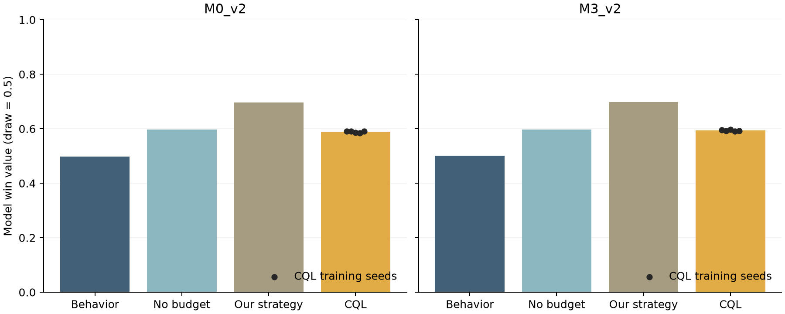
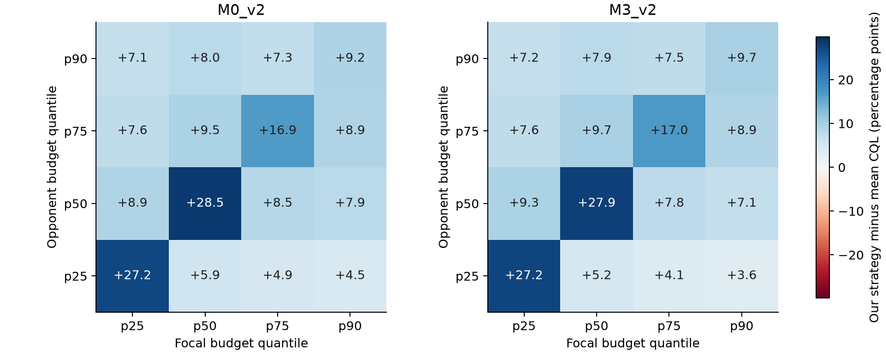

# CQL v2: 문맥과 support를 고려한 전술 추천

## 1. 원인 / 하는 이유 / 개요

GRU 확률만으로 다음 행동을 고를 수 없어, 실제 기록으로부터 행동별 return을 학습하는 offline 정책을 추가했다. 이전 CQL v1의 행동·보상·문맥 구성은 v2로 대체되었으므로 v1 checkpoint·추천·지표는 게시하지 않는다.

## 2. 과정

frozen GRU hidden과 사전 관측 변수, 이전 타구/위치 문맥을 결합한 107차원 상태를 구성했다. train support≥50인 84개 (타구,Z1–Z16) 행동과 문맥별 mask를 사용했다. 같은 선수 t→t+2 macro-transition, terminal ±1 보상, gamma=0.99를 사용했고 action-balanced sampling으로 학습했다. alpha 후보와 epoch는 validation 기준으로 선택했다. 게시본 CLI 기본 경로는 configs/cql_config_v2.yaml과 outputs/cql_v2로 맞췄다.

의존 단계: 01 데이터 + 02 GRU/frozen hidden. `code/`에는 이 주제가 소유하는 실행 코드·설정·테스트가 있다. 다른 단계의 공통 코드를 중복 복사하지 않으며 루트 `run.py`가 실행 환경을 조립한다.

저장소 루트에서 실행한다:

```powershell
python run.py cql-build
python run.py cql-train
python run.py cql-evaluate
```

## 3. 결과

| 항목 | 결과 |
| --- | --- |
| 입력 차원 | 107.000000 |
| 파라미터 | 41172.000000 |
| 행동 수 | 84.000000 |
| test 상태 | 10033.000000 |
| 타구 종류 일치율 | 0.540616 |
| 타구·구획 완전 일치율 | 0.206120 |
| top-3 일치율 | 0.389814 |
| 실제 행동 평균 Q-rank | 6.272769 |
| 동일 타구 목표구획 거리(m) | 1.412090 |
| 추천 행동 종류 | 47.000000 |

선택 alpha=0.5, best epoch=5. [test 지표](results/cql_v2/metrics/cql_metrics.json), [추천](results/cql_v2/predictions/cql_test_recommendations.csv), [checkpoint](results/cql_v2/model/best_cql_model.pt). Z0·전역 저지원 추천은 0이며 문맥 backoff가 사용되는 상태가 존재한다. Q는 승률이 아니라 학습된 할인 return이다. 실제 행동과의 일치율은 정책의 우월성 검증이 아니므로 07 OPE를 별도로 수행했다.

결과를 다시 만들면 `.runtime/outputs` 또는 `.runtime/data`에 저장된다. 검토 후 `python run.py sync-results`로 주제별 `results/`를 갱신한다. 대용량 원자료·예산 격자 제외 기준과 완전한 Parquet 보존 여부는 루트 [PUBLICATION_MANIFEST.json](../PUBLICATION_MANIFEST.json)에 기록했다.

### 공통 상태를 사용하는 예산 CQL 확장

11번 통합 비용이 main에 반영된 뒤 M0_v2와 M3_v2 각각의 별도 run에서 replay와 CQL 본 학습을 수행한다. 비교 환경은 학습 경기로 적합한 strict M0 종료확률과 상대 pi*T를 공통 사용하고, 계산된 명시적 예산 전략·예산을 무시한 전략·관측 행동 분포·5개 CQL을 같은 시작 상태와 난수로 평가한다. 자연 종료의 마지막 스윙도 비용에 포함한다. 각 비용에서 수학적 전략을 다시 계산하고 CQL도 따로 학습하며, 기존 전략의 결과를 새 비용의 결과로 대체해 표시하지 않는다. 비용 이름 M0/M3와 종료 모형의 strict M0는 서로 다른 분류다.

우리 예산 전략과 같은 정보로 학습하는 별도 CQL 경로를 추가하였다. 입력은 최근 세 구역의 one-hot 48개, A/B 타구 차례 1개, 학습 비용 p90으로 정규화한 양측 남은 예산 2개로 51차원이다. 기존 107차원 CQL v2와 checkpoint는 보존한다. 행동은 고정된 128개 타구/구역 슬롯이며, 05와 같은 학습 자료 기반 support 마스크를 사용한다. 보상은 승패 +/-1, 동시 소진 0, gamma=1이다.

세 구역이 확보되는 4번째 타구 직전에 예산을 부여하고 이후의 비용을 반영한다. 같은 선수의 다음 차례까지 양측 비용을 차감하며, 자연 종료는 관측 승패와 마지막 스윙만, 계속 전이는 이동과 스윙을 부과한 뒤 예산 소진을 판정한다. 목표가 Z0인 종료 타구에는 관측된 목표 의도가 없으므로 학습 자료의 계속 타구 구역 분포로 가중 분할하고 이를 관측 행동과 구별하였다. 목표가 기록된 마지막 타구는 해당 구역을 보존한다.

9·10 통합 비용은 11번 주제에서 제공한다. 이 확장은 완전한 계속/종료 비용표를 받는 입력 계약, 실제 기록 replay, CQL 학습, 고정 정책 adapter, 보조 FQE 진단을 제공한다. 비용·마스크 해시가 바뀌면 새 replay와 재학습이 필요하다. 입력 형식, 실행 명령, 정책 호출 방법은 [연결 문서](code/BUDGET_CQL_HANDOFF.md)에 정리하였다. 아래의 기존 비용 연결 시험과 통합 비용 본 학습은 서로 다른 실행이다.

기준 비용 연결 실행은 `20261104-budget-cql-reference-v3-codex`이다. 기존 10/M0를 provisional 입력으로 사용하고 alpha=0.5, seed 42..46, 각 2 epoch의 CQL 및 2 epoch의 FQE로 실행 경로를 확인하였다. alpha 탐색이나 충분한 최종 학습을 수행한 결과로 해석하지 않는다. 코드 기준 commit은 `537ff7ddaf4d85e0bcb19b3298bae46f10ad75dd`이며 개발 중의 v1/v2 실행은 게시하지 않았다.

| 연결 시험 항목 | train | validation | test |
|---|---:|---:|---:|
| 원자료 랠리 수 | 4,035 | 876 | 966 |
| 4타구 이후 적격 랠리 수 | 3,392 | 753 | 816 |
| replay 행 수, 목표 가중 분할 포함 | 360,170 | 80,773 | 86,835 |
| 원 결정/예산 조합의 가중치 합 | 234,959 | 53,748 | 56,116 |
| 목표 미상 종료 가중치 비중 | 7.379% | 6.984% | 7.591% |

공통 마스크가 허용하는 전역 타구/구역 조합은 68개다. 5개 seed의 test 추천에서 support 위반은 모두 0이었다. 원자료에 목표가 기록된 표본에서 행동 일치율은 9.796~10.707%였으며, 보조 FQE의 적격 시작 상태 평균 return은 0.2725~0.2931이었다. 짧은 연결 시험의 진단 수치이며 전략의 승률이나 우열을 나타내지 않는다. 전체 test replay의 비용 차감·잔여량과 가중치 합을 대조했고, 저장 모델 5개의 adapter 추천 64개씩 총 320개가 진단 파일과 완전히 일치하였다. 연구 테스트 117개와 저장소 규칙 테스트 6개가 통과하였다.

근거: [데이터 RUN](results/budget_cql/runs/20261104-budget-cql-reference-v3-codex/RUN.json), [공통 계약](results/budget_cql/runs/20261104-budget-cql-reference-v3-codex/dataset_contract.json), [전체 감사표](results/budget_cql/runs/20261104-budget-cql-reference-v3-codex/dataset_audit.json), [학습 RUN](results/budget_cql/runs/20261104-budget-cql-reference-v3-codex/training/20261104-connection-5seeds/RUN.json), [5개 모델과 학습 지표](results/budget_cql/runs/20261104-budget-cql-reference-v3-codex/training/20261104-connection-5seeds/training_summary.json), [보조 진단](results/budget_cql/runs/20261104-budget-cql-reference-v3-codex/diagnostics/20261104-fqe-connection/diagnostics.json).

### M0_v2와 M3_v2의 독립 본 학습

11번의 `20261104-integrated-v2-kinggoddowon` 비용표와 종료 lookup의 입력 12개, 출력 37개의 해시를 확인한 뒤 두 비용을 독립적으로 연결하였다. `cost_status=validated`는 이 비용표의 전수 키·성분·대칭·전달 계산 검사를 통과했다는 뜻이다. 비용 자체의 생리학적 타당성을 입증한 상태 표시는 아니다. 비용 집계표의 최종 적합에는 train+validation 특징이 사용되었고 test는 사용되지 않았다. CQL의 행동 지원, 예산 척도와 평가 환경의 종료확률·상대 분포는 train으로만 정하였다.

| 항목 | M0_v2 | M3_v2 |
|---|---:|---:|
| train replay 행 수 | 359,176 | 358,958 |
| validation replay 행 수 | 80,605 | 80,422 |
| test replay 행 수 | 85,993 | 85,935 |
| train 원 결정/예산 조합 가중치 합 | 233,712 | 233,704 |
| validation 가중치 합 | 53,695 | 53,628 |
| test 가중치 합 | 55,546 | 55,552 |
| 예산 p25 | 102.4528 | 103.5150 |
| 예산 p50 | 251.5154 | 255.6107 |
| 예산 p75 | 479.5064 | 488.3151 |
| 예산 p90 | 806.4014 | 826.1299 |
| 선택 alpha | 0.1 | 0.1 |
| seed 42..46 선택 epoch | 5, 4, 4, 5, 4 | 5, 5, 4, 5, 4 |

예산 단위는 비용 모형의 J/kg 대리량이며, 4번째 타구부터의 학습 선수별 양의 소비량 6,408개에서 분위수를 구하였다(전체 6,784개 중 소비량 0인 376개 제외). M0와 M3는 같은 분위수 규칙을 사용하되 숫자는 각 비용으로 새로 계산한다. 따라서 두 모형의 조건은 같은 분위수 시나리오이지 같은 물리적 자원량이라고 해석하지 않는다.

두 run 모두 128-128 ReLU 망, 학습률 0.0003, 배치 1,024, action-balanced 지수 0.5, 최대 60 epoch와 patience 12를 사용하였다. seed 42에서 alpha 0.1/0.25/0.5를 탐색해 가중 validation TD가 가장 작은 0.1을 선택한 뒤 seed 42..46을 학습하였다. 각 seed는 16~17 epoch에서 조기 종료하였다. test는 설정 선택에 사용하지 않았다. TD 손실은 설정 선택용 대리 지표다.

공통 평가에서는 train으로 적합한 strict M0 종료 모형과 train의 상대 타구/구역 분포를 고정한다. **M0_v2와 M3_v2 각각에서 수학적 전략을 다시 계산하고, 그 비용으로 학습한 CQL과 비교한다.** 각 모형 안에서 16개 예산 조합과 두 초기 타구 차례의 32조건, 조건당 20,000회의 공통 난수를 적용한다. 초기 상태는 적격 train 랠리 3,392개의 4번째 타구 직전 분포에서 추출하고 처음 타구하는 선수를 평가 대상으로 정한다. 계속 전이의 양측 비용과 자연 종료의 마지막 스윙은 모든 정책에서 동일하게 처리한다. 추가로 상대 분포 temperature 0.75/1.25, 전체 비용 배수 0.9/1.1의 24조건을 평가한다.

이 비교는 수학적 전략을 계산한 동일한 추정 환경 안의 비교다. CQL 학습 seed 변동과 조건부 Monte Carlo 오차를 구분하고, 환경·비용 추정의 불확실성이 Monte Carlo 구간에 포함되지 않음을 명시한다. 목표 구역에 도착한다는 가정과 마지막 타구의 미상 구역 가중 분할 가정을 공유한다. 새 보조 FQE는 이 상태·보상·종료 규칙으로 계산하며 기존 07 OPE와 연결하지 않는다.
| 비용 | 데이터 실행 | 본 학습 | 보조 진단 |
|---|---|---|---|
| M0_v2 | [replay와 비용](results/budget_cql/runs/20261104-budget-cql-integrated-M0-codex/RUN.json) | [alpha와 5개 seed](results/budget_cql/runs/20261104-budget-cql-integrated-M0-codex/training/20261104-full-5seeds/training_summary.json) | [보조 FQE](results/budget_cql/runs/20261104-budget-cql-integrated-M0-codex/diagnostics/20261104-full-fqe/diagnostics.json) |
| M3_v2 | [replay와 비용](results/budget_cql/runs/20261104-budget-cql-integrated-M3-codex/RUN.json) | [alpha와 5개 seed](results/budget_cql/runs/20261104-budget-cql-integrated-M3-codex/training/20261104-full-5seeds/training_summary.json) | [보조 FQE](results/budget_cql/runs/20261104-budget-cql-integrated-M3-codex/diagnostics/20261104-full-fqe/diagnostics.json) |

두 비용의 10개 저장 모델에서 seed별 64개씩 총 640개 adapter 추천을 진단 파일과 대조해 완전 일치를 확인하였다. 두 replay 전체 1,051,089행의 비용 차감·잔여량·행동 마스크·상태 인코딩·보상을 대조하였다. 학습 배열의 종료 다음 상태는 bootstrap을 하지 않으므로 0으로 저장하며, 별도 행 기록에는 종료 후 잔여량을 보존한다. test 추천의 공통 마스크 위반은 0이었다. FQE의 시작 상태 평균 return은 M0에서 0.6820~0.7020, M3에서 0.6676~0.6847이며, 함수 근사값 일부는 보상 범위 [-1,1] 밖에 있다. 이 진단을 확률로 변환하거나 승률 비교를 대신하는 근거로 사용하지 않는다. [전수 대조와 모델 재현 검사](results/runs/20261104-integrated-cql-verification-codex/RUN.json)에 코드와 표를 보존하였다.

### 동일 모형 안의 정책 비교

M0_v2와 M3_v2 각각에서 CQL 5개 seed와 수학적 전략을 독립적으로 학습·계산하였다. 같은 비용 안의 정책들은 train으로 적합한 상대 분포, 종료확률, 공통 행동 마스크, 초기 상태·예산 및 난수를 공유한다. 기본 32조건과 민감도 24조건에서 정책 8개를 조건당 20,000회 평가하여 비용별 8,960,000회, 총 17,920,000회의 모의 랠리를 완료하였다. 아래 값은 무승부를 0.5로 둔 모형 승리 가치다.

| 비용 | 우리 예산 전략 | CQL 5 seed 평균 | 예산 무시 전략 | 지원 제한 경험 정책 | 우리 전략 - CQL (%p) | 차이의 조건부 95% MC 구간 (%p) |
|---|---:|---:|---:|---:|---:|---:|
| M0_v2 | 69.5534% | 58.8707% | 59.6891% | 49.8432% | +10.6827 | [10.5958, 10.7697] |
| M3_v2 | 69.8279% | 59.3493% | 59.6898% | 50.0791% | +10.4786 | [10.3934, 10.5638] |

기본 32조건을 동일 가중하고 CQL은 5개 학습 seed를 평균하였다. 구간은 같은 trial에서 CQL의 seed 평균과 우리 전략의 차이를 구한 뒤 독립적인 조건별 분산을 합한 Monte Carlo 구간이다. CQL의 학습 변동은 이 구간과 따로 보고한다.

| 비용 | CQL seed별 평균의 표준편차 (%p) | seed별 평균 범위 |
|---|---:|---:|
| M0_v2 | 0.3051 | 58.4702% - 59.1440% |
| M3_v2 | 0.2414 | 59.1359% - 59.6909% |

[전체 조건과 공통 난수 차이](results/runs/20261105-integrated-policy-comparison-codex/condition_comparison.csv), [정책별 지표](results/runs/20261105-integrated-policy-comparison-codex/policy_metrics.csv), [요약 RUN](results/runs/20261105-integrated-policy-comparison-codex/RUN.json)을 제공한다.



그림: 기본 32조건의 동일 가중 평균. 점은 CQL의 5개 학습 seed이며 환경 추정 오차 구간이 아니다.



그림: 자기·상대 예산 분위수별 우리 전략과 CQL seed 평균의 차이(%p). 두 초기 타구 차례를 평균하였다.

### 비용, 소진과 자료 지원

| 비용 | 정책 | 자기 평균 비용 (대리량 J/kg) | 상대 평균 비용 | 자기 소진율 | 상대 소진율 | 동시 소진율 | 시작 이후 평균 타수 |
|---|---|---:|---:|---:|---:|---:|---:|
| M0_v2 | 우리 예산 전략 | 136.161 | 141.567 | 10.183% | 37.362% | 0.575% | 3.938 |
| M0_v2 | CQL 5 seed 평균 | 130.552 | 122.592 | 18.093% | 22.483% | 2.613% | 3.993 |
| M0_v2 | 예산 무시 전략 | 126.281 | 109.248 | 20.020% | 15.746% | 2.359% | 3.835 |
| M0_v2 | 지원 제한 경험 정책 | 160.749 | 169.151 | 26.642% | 28.633% | 4.581% | 4.377 |
| M3_v2 | 우리 예산 전략 | 136.854 | 144.727 | 9.986% | 38.062% | 0.523% | 3.914 |
| M3_v2 | CQL 5 seed 평균 | 133.816 | 128.567 | 17.699% | 23.994% | 2.285% | 3.999 |
| M3_v2 | 예산 무시 전략 | 127.517 | 109.589 | 19.835% | 15.424% | 2.197% | 3.854 |
| M3_v2 | 지원 제한 경험 정책 | 162.919 | 172.946 | 26.310% | 28.754% | 4.278% | 4.369 |

비용은 종료까지 차감한 모형 비용이고 평균 타수는 4번째 타구부터 종료까지다. 자기·상대 소진율은 각각 동시 소진도 포함한다. 관측 목표 구역을 제어 가능한 행동으로 취급하는 가정 아래의 결과이며 타구 정확도, 대사비용 또는 실제 경기 승률을 검증한 값이 아니다.

| 비용 | 추천된 행동의 학습 문맥 관측 수 최소 | 가중 중앙값의 seed 범위 | 가중 평균의 seed 범위 |
|---|---:|---:|---:|
| M0_v2 | 5 | 13.0 - 14.0 | 23.15 - 24.42 |
| M3_v2 | 5 | 13.0 - 14.0 | 23.65 - 24.59 |

위 지원 수는 held-out test replay에서 추천한 행동이 선택된 train backoff 문맥에서 관측된 횟수다. 목표 미상 분할 가중치를 사용하며 rollout 방문 상태의 지원 분포와는 다르다. [seed별 전수 지표](results/runs/20261105-integrated-policy-comparison-codex/recommendation_support.csv)에 분모와 분위수를 보존하였다.

### 상대 분포와 비용 추정치의 민감도

| 비용 | 조건 | 우리 전략 | CQL 평균 | 차이 (%p) |
|---|---|---:|---:|---:|
| M0_v2 | nominal_matched | 70.3787% | 56.9892% | +13.3896 |
| M0_v2 | opponent_T075 | 70.9100% | 56.8716% | +14.0384 |
| M0_v2 | opponent_T125 | 70.1704% | 57.0787% | +13.0917 |
| M0_v2 | cost090 | 67.4983% | 57.4801% | +10.0183 |
| M0_v2 | cost110 | 69.3921% | 56.5274% | +12.8647 |
| M3_v2 | nominal_matched | 70.6167% | 57.7352% | +12.8814 |
| M3_v2 | opponent_T075 | 71.1500% | 57.5565% | +13.5935 |
| M3_v2 | opponent_T125 | 70.3317% | 57.8528% | +12.4788 |
| M3_v2 | cost090 | 68.1763% | 58.2018% | +9.9744 |
| M3_v2 | cost110 | 69.7092% | 57.2145% | +12.4947 |

각 변화에서 해당 비용으로 학습·계산한 정책을 고정하였다. 기준 nominal_matched는 변화 조건과 같은 6개 예산·차례 조합이며 기본 32조건 평균과 구별한다. 상대 온도는 joint 타구·구역 분포 전체에 적용한다. M0/M3의 예산은 비용별로 다시 계산한 분위수이므로 두 비용 간 차이를 같은 물리적 자원의 효과로 해석하지 않는다.

### 수치 검증과 실패 기록의 보존

| 비용 | 정밀화 | 선정 128질의 최대 차이 | Bellman 최대 잔차 | 정확 비용 MC 구간 밖 최대 차이 | MC 검사 통과 |
|---|---:|---:|---:|---:|---:|
| M0_v2 | 160 → 320 | 0.015148727 | 9.999e-12 | 0.004255159 | 32/32 |
| M3_v2 | 200 → 400 | 0.017951798 | 0 | 0.005475017 | 32/32 |

연속 격자의 선정 질의 차이는 0.02 이하, Bellman 잔차는 1e-10 이하를 요구하였다. Monte Carlo 검사는 격자 기대값과 정확한 연속 비용 rollout 평균의 절대 차이에서 95% MC 오차를 뺀 값이 0.02 이하인지 확인한다. 선정 질의와 동일 모형 안의 수치 검사이며 전체 예산 영역에 대한 균일 오차 증명은 아니다.

M0와 M3의 80→160 차이는 각각 0.0337859882, 0.0401032710으로 실패하였다. M3 160→320도 로그의 여섯 자리에서 0.020123으로 기준을 넘었고 이후 13.5GB 배열 저장 중 공간 부족으로 중단되었다. 이 세 시도에서 정책 비교는 실행되지 않았다. 실패 RUN과 불완전 파일의 크기·해시를 보존하며 완료 비교와 구별한다.

M3 후속 계산은 승리 가치에 영향을 주지 않는 독립 ambiguity 확률 채널만 생략하였다. float64 승리 가치 식, 비용, tie breaking과 무승부 값 0.5는 같다. 작은 검증 환경의 양측 관점·소진 예제에서 기존 격자의 전 값을 대조했고 최종 정확 비용 Monte Carlo 검사를 유지했다. 남길 모든 정밀화 파일과 1GiB 여유 공간을 사전 확인하고 최종 파일을 미리 할당해 추가 대형 저장 복사를 피하였다.

실패 격자 및 불완전 파일의 무손실 압축은 [첫 보관 기록](results/runs/20261105-grid-storage-recovery-codex/RUN.json)에, 완료 M0 격자의 추가 무손실 보관은 [완료 격자 보관 기록](results/runs/20261105-complete-grid-storage-codex/RUN.json)에 보존하였다. 압축 해제 스트림의 SHA256가 원본과 일치한 뒤 비압축 사본을 대체했다. 학습 데이터, 모델과 기존 과학적 결과를 바꾸지 않았다. M0 격자 재사용에는 RESTORE.md에 따라 원래 해시를 복원해야 한다.

### 재현과 비교 범위

완료 비교 RUN은 [M0](results/budget_cql/runs/20261104-budget-cql-integrated-M0-codex/comparison/20261104-common-model-refined/RUN.json), [M3](results/budget_cql/runs/20261104-budget-cql-integrated-M3-codex/comparison/20261105-common-model-resolution400/RUN.json)다. 대형 격자는 GitHub 일반 파일에서 제외하고 각 large_artifacts.json에 전체 크기·SHA256를 기록하였다. 요약 표·그림은 게시된 전체 paired archive와 진단 파일만으로 재생성할 수 있다.

```powershell
python run.py prepare
python 03_cql_v2_policy/code/scripts/summarize_integrated_comparison.py --m0 .runtime/outputs/budget_cql/runs/20261104-budget-cql-integrated-M0-codex --m3 .runtime/outputs/budget_cql/runs/20261104-budget-cql-integrated-M3-codex --m0-comparison-id 20261104-common-model-refined --m3-comparison-id 20261105-common-model-resolution400 --out 03_cql_v2_policy/results/runs/<new-summary-id>
python run.py budget-cql-compare --run-id 20261104-budget-cql-integrated-M3-codex --training-id 20261104-full-5seeds --comparison-id <new-comparison-id> --grid-intervals 400 --max-grid-intervals 400 --mean-only-grid
```

M0를 처음부터 재계산할 때는 M0 run과 320구간을 사용한다. 완료된 학습과 비교를 확인하는 데 CQL 재학습은 필요하지 않다. 연구 테스트 149개와 저장소 규칙 테스트 6개가 통과하였다. 코드·수치 의존성·비용과 실행 해시를 고정해 완료 결과를 재현한다.

이 비교는 수학적 전략을 계산한 추정 환경 안의 비교다. 수학적 전략은 평가에 사용한 확률·비용 모형을 직접 최적화하므로 모형 안에서 유리할 수 있다. 상대의 전략 적응, 정확한 목표 실행과 실제 피로 변화는 평가하지 않았다. Monte Carlo 구간은 고정된 환경의 표본 오차만 포함하고 비용·종료확률 추정 오차를 포함하지 않는다. 보조 FQE의 근사값으로 정책 우열을 대체하지 않는다.
