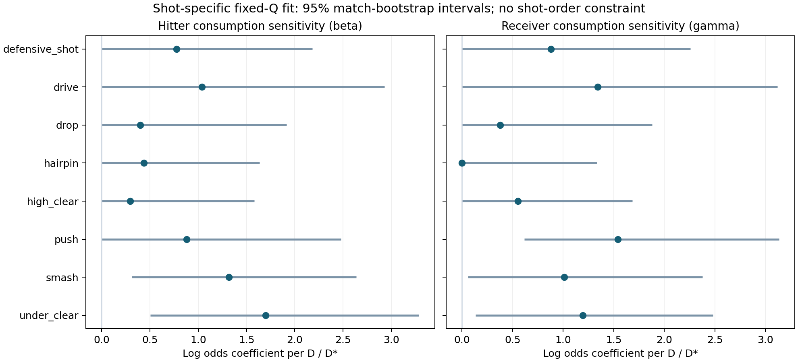

# 고정 Q 샷별 체력 민감도: 실행 결과

## 1. 원인 / 하는 이유 / 개요

기존 Q와 샷별 종료질량을 보존하고, 타구자 관점의 즉시 득점 대 실점 비율을 샷별 누적 이동부하로 보정했다. β,γ는 비음수이고 샷 사이의 배수·순서 제약은 없다. 생리적 체력이나 인과효과의 측정이 아니다.

## 2. 과정

[프로토콜](protocol.json)에 기준표·비용·경기 분할·5-fold 기준 확률·정규화와 ridge 선택을 기록했다. 종료 타구의 실제 타구자 승패만 사용하며 E/U 원인 라벨은 선택·정답에 사용하지 않는다. 개발 계수는 train으로 적합하고 validation으로 ridge를 고른 뒤 test에서 동결 평가했다. 배포 계수는 train+validation으로 다시 적합했다.

경기 bootstrap은 샷별 계수와 fold별 기준 odds를 재적합한다. 비용표·누적량 대체·D_*·fold·history/ridge 선택은 고정하므로 구간은 이 조건에 의존한다. 기존 Q/C와 E/U 결과는 교체하지 않았다.

## 3. 결과

| test 모형 | 종료 표본 | 조건부 log loss | Brier |
|---|---:|---:|---:|
| original | 816 | 0.561456 | 0.186083 |
| intercept | 816 | 0.561224 | 0.186045 |
| common | 816 | 0.561620 | 0.186256 |
| shot | 816 | 0.563754 | 0.186953 |

[샷별 계수와 구간](coefficients.csv), [개별 시험 예측](predictions.parquet), [식별 진단](identifiability.csv), [확률 보존 검사](invariants.json).

shot−intercept log loss 차이는 0.002530, 경기 bootstrap 95% 구간은 [-0.0007386844438877969, 0.0063193823315441855]다. 음수일수록 개선이며 0 포함 여부를 함께 해석한다.

| 샷 | 최종 a | 최종 β | 최종 γ |
|---|---:|---:|---:|
| defensive_shot | -0.012539 | 0.776323 | 0.877923 |
| drive | -0.130385 | 1.036861 | 1.342730 |
| drop | 0.000520 | 0.397400 | 0.375672 |
| hairpin | 0.173704 | 0.435121 | 0.000000 |
| high_clear | -0.124835 | 0.292519 | 0.551514 |
| push | -0.278985 | 0.879437 | 1.540763 |
| smash | 0.115534 | 1.315919 | 1.011420 |
| under_clear | 0.177923 | 1.698420 | 1.195943 |

β_smash−β_high_clear=1.023400; bootstrap 95% 구간 [-0.3374319956826726, 2.150656380023986]. 두 샷의 순서를 강제하지 않은 결과다.

H/R 소모량이 함께 증가하면 두 민감도를 분리하기 어렵다. 샷별 상관·조건수와 경계 계수 비율을 같이 보고, 음이 아닌 제약의 경계에 걸린 값을 효과 부재의 확정 증거로 해석하지 않는다.

[예산 격자와 Monte Carlo](stamina_validation.csv)는 평균 전이 비용과 제로 종료 추가비용을 사용한 수치 검증이다. 동시 소진 순서가 미관측이므로 하한·중앙·상한을 구분한다. 초기 예산은 train 종료 소비량의 분위수 시나리오이며 최대체력 추정값이 아니다.
질의 54개, 최대 midpoint 오차 0.011897, 모든 허용오차 검사 통과=True.
전체 격자는 [로컬 산출물 해시](local_grid_artifacts.json)와 재생성 명령으로 추적한다. 공개 query 표를 전체 격자로 표현하지 않는다.
