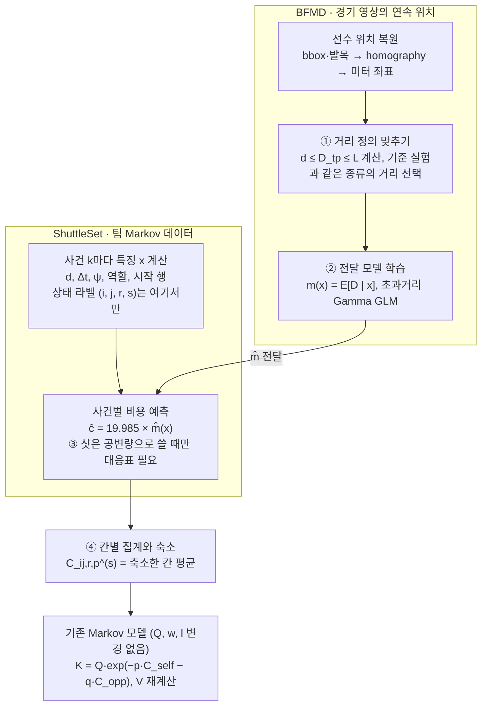

# 배드민턴 Markov 이동비용 C 추정 방법

작성 2026-10-13 · 갱신 2026-10-14 · 팀 공유 문서(Claude Docs)를 저장소용 Markdown으로 옮긴 것

## 개요

이동비용 C는 BFMD 경기 궤적으로 "직선거리 → 실제 이동거리" 관계를 학습하고, 이를 팀의 ShuttleSet 사건마다 적용한 뒤 Markov 칸별로 모아서 구한다. 지금 C는 19.985 J/(kg·m) × (연속 타구 시점 위치 사이 직선거리)라서, 한 전이 안에서 방향을 바꾸거나 갔다 오는 움직임을 놓친다.

이 방법은 세 가지 문제를 함께 해결한다.

- **거리 정의**: 19.985가 곱해지는 "1 m"의 종류를 기준 실험(Pugliese 2025)과 맞춘다. → 1단계
- **표본 희소성**: BFMD 단식 12경기로 (i, j, r, p, s) 칸을 직접 채우지 않고, 두 데이터에서 똑같이 계산되는 운동 특징으로 이동거리를 예측한다. → 2단계
- **라벨 대응**: Markov 상태 라벨은 ShuttleSet에서만 붙이므로, BFMD의 구역·샷 체계를 상태로 옮길 필요가 거의 없다. → 3단계

바꾸지 않는 것은 전이확률 Q, 종료확률 w·l, 승률 계산과 solver, parity 규약이다. 바뀌는 것은 `transition_costs` 표 하나이며, 출력 형식도 지금 표와 맞춘다.

결과는 "운동학적으로 보정한 에너지 등가 비용"이지 실측 대사에너지가 아니다. BFMD에는 대사 측정값이 없기 때문이다. 구역·샷·거리 규약과 BFMD 스키마는 팀 저장소(2026-10-14 main)의 코드와 감사 결과로 확인했다. Pugliese 실험의 거리 정의는 아직 미확인이다.

## 현재 모델 요약

지금 C는 parity별·샷별·다음 구역별로 직선거리 평균을 축소한 뒤 19.985를 곱한 값이다(`markov_parity` README 기준). 새 방법은 아래 규약을 모두 그대로 따른다.

| 항목 | 현재 정의 |
| --- | --- |
| 상태 | i = (z\_{t−3}, z\_{t−2}, z\_{t−1}), 16구역 → 4,096 패턴 × parity 2 = 8,192 상태 |
| parity | r = 0: A–B–A(현재 타구자 B), r = 1: B–A–B(현재 타구자 A) |
| 비용 구간 | 행 t의 샷에 대해 행 t → t+1 사이의 이동, 샷 라벨 s = s\_t |
| 거리 | 연속 타구 시점의 주석 위치 사이 직선거리 |
| 축소 | n/(n+τ)·(칸 평균) + τ/(n+τ)·(부모 평균), τ = 1.0 (validation RMSE로 선택) |
| 부모 계층 | parity·샷·다음 구역 → parity·샷 → parity 전체 |
| 계수 | 19.985 J/(kg·m) = side step 19.59와 running step 20.38의 산술평균 |
| 선수 첨자 p | self = 기준 선수 A, opp = B |
| 종료 전이 | 비용 없음 |

현재 거리 추정의 검증 RMSE는 약 0.66 m(test 0.67 m)이다. 직선거리 자체의 예측 오차이지, 실제 이동거리와의 차이를 본 값은 아니다.

새 방법에서는 각 선수의 **역할**이 중요하다. 타구자는 친 뒤 복귀하고, 리시버는 다음 타구 위치로 접근한다. 역할은 parity에서 바로 정해진다.

| parity r | 현재 타구자 | self(A)의 역할 | opp(B)의 역할 |
| --- | --- | --- | --- |
| 0 | B | 리시버(접근) | 타구자(복귀) |
| 1 | A | 타구자(복귀) | 리시버(접근) |

구역은 팀 코드(`01_data_16zone/code/src/merge_datasets.py`)에서 확인했다. 셔틀 착지 위치를 받는 선수의 반코트 기준으로 돌린 뒤, 단식 폭 5.18 m와 반코트 길이 6.70 m를 각각 1:2:2:1로 나눈다. Z1–Z4가 엔드라인 행, Z13–Z16이 네트 행이고, 행 안에서는 받는 선수 기준 왼쪽→오른쪽이다. 코트 밖·네트는 Z0이다. 시간 특징은 프레임 차이/30(30 fps 고정)이며, 영상별 실제 fps는 재검증하지 않았다.

## 팀 저장소 확인 결과

팀 저장소(2026-10-14 main)에는 이 문서 1–2단계의 일부가 이미 `08_bfmd_kinematics`로 구현돼 있다. 차이는 무엇을 예측하고, 그 결과를 Markov 칸에 어떻게 적용하느냐다.

| 항목 | 08 현재 구현 | 이 문서의 방법 |
| --- | --- | --- |
| 예측 대상 | 이동시간 T로 그룹 수준을 고르고, 같은 그룹의 L·운동학 특징 평균을 비용에 사용 | 이동거리 D(초과거리 Δ)를 직접 예측 |
| 조건 | 직선 변위 5분위 구간 + 역할 + 샷 | d(연속값), Δt, ψ, 역할, 시작 행 |
| Markov 적용 | 칸의 평균 직선 변위(기존 C의 축소값)로 구간을 찾아 적용 | ShuttleSet 사건마다 예측한 뒤 칸별 평균 |
| 거리 종류 | L(경로 길이), M0 = 19.985·L | D\_tp 기본, L은 민감도 |
| 칸 정확 관측 | n = 0(BFMD에 착지 history 없음), 전 행 fallback | BFMD에서 칸을 만들지 않아 해당 없음 |
| 불확실성 | BFMD 경기 bootstrap 100회 | BFMD·ShuttleSet 두 단계 bootstrap |

08은 스스로도 "칸 평균 변위에 구간 평균을 적용하면 칸 안의 이질성이 빠진다"고 기록했다. 사건별 적용이 그 한계를 바로 해결한다.

### BFMD 실측에서 확인한 것

08의 `motion_features.parquet`에서 완전 관측된 중간 랠리 전이 7,206건을 다시 집계했다.

- 경로 길이 L은 직선거리 d의 1.45배(합계 기준), 전이별 중앙값은 1.38배다.
- 초과분 L − d는 d ≤ 0.25 m인 짧은 전이에서도 평균 0.43 m이고, d가 3 m를 넘어도 0.62 m 정도다. 비율보다 거의 일정한 덧셈 항에 가까워, 2단계의 "현 거리 + 초과분" 모델과 맞는다.
- 이 0.43 m가 실제 스플릿 스텝·미세 조정인지 추적 잡음인지는 아직 모른다. bbox와 발목 위치의 중앙 차이가 0.935 m라 잡음 몫이 클 수 있다. 잡음이라면 L 기반 M0는 전이마다 약 8.6 J/kg(0.43 × 19.985)를 일정하게 더해, 짧은 전이와 긴 랠리의 비용을 부풀린다. 일정한 배수와 달리 이런 덧셈 항은 파레토 프런티어를 바꿀 수 있어, D\_tp와의 비교가 필요하다.
- 샷별 L/d 비율은 1.35–1.51로 좁다. 반면 08의 이동시간 T 예측에서는 샷을 넣으면 test MAE가 0.204 s에서 0.130 s로 줄었다. 거리에서 샷이 Δt 뒤에도 정보를 더하는지는 3단계의 비교로 가린다.
- 리시버의 평균 d는 1.38 m, 타구자는 0.95 m로 역할 차이가 크다.
- BFMD 경기(2023–2025)와 ShuttleSet 경기(2018–2022)는 겹치지 않는다. 위치 측정 보정은 분포 기반으로만 가능하다.

## 전체 구조

C는 네 단계를 거쳐 만들어진다. BFMD는 1–2단계(거리 관계 학습)에만 쓰이고, 상태 라벨과 칸 집계는 모두 ShuttleSet에서 이루어진다.



BFMD 쪽은 "직선거리와 운동 특징이 주어졌을 때 실제로 얼마나 움직이는가"를 배우고, ShuttleSet 쪽은 그 함수를 팀 데이터의 사건마다 적용한다.

최종 식은 다음과 같다.

```math
C^{(s)}_{ij,r,p} = \frac{n}{n+\tau} \cdot \frac{1}{n} \sum_{k \in (i,j,r,s)} 19.985 \, \hat m(x_{k,p}) + \frac{\tau}{n+\tau} \, C_{\mathrm{parent}}, \qquad \hat m(x) = d + \exp(\hat\gamma^{\top} \tilde x)
```

지금 식과 다른 점은 하나다. 사건별 거리가 직선거리 d에서, BFMD로 학습한 예상 이동거리 m̂(x)로 바뀐다. 축소 구조와 부모 계층은 그대로다.

## 1단계: 거리 정의 맞추기

19.985는 "어떤 종류의 거리 1 m당" 비용이므로, 기준 실험과 같은 종류의 거리에만 곱해야 한다. BFMD 궤적에서 전이 \[f\_k, f\_{k+1}) 동안 선수 p의 거리를 세 가지로 계산하고, 기준 실험에 맞는 하나를 고른다.

### 위치 복원

1. `player_bbox` 하단 중심 (x + w/2, y + h)을 픽셀로 바꾸고(원본 단위는 0–100 %), pose 양쪽 발목(COCO 15, 16)과 비교한다.
2. `court_perframe`의 `valid` 프레임에서만 homography로 바닥 평면 미터 좌표 y\_p(f)를 만든다. `no_court`는 변환하지 않는다.
3. 게임별 코트 교대로 Top/Bottom과 A/B가 바뀔 수 있으므로 `game1_top_player`, `hit_inferred.player`로 교차 확인한다.
4. 이 위치는 신체 무게중심이 아니라 "바닥 위치 대리변수"라고 부른다.

### 세 가지 거리

```math
d_{k,p} = \lVert y_p(f_{k+1}) - y_p(f_k) \rVert
```

**현 거리 d**: 두 타구 시점 위치 사이 직선거리. 지금 팀이 쓰는 값과 같은 정의다.

```math
D^{tp}_{k,p} = \sum_{m=0}^{M-1} \lVert \tilde y_p(\tau_{m+1}) - \tilde y_p(\tau_m) \rVert, \quad f_k = \tau_0 < \tau_1 < \dots < \tau_M = f_{k+1}
```

**전환점 꺾은선 거리 D\_tp**: 평활한 궤적 ỹ에서 멈춤이나 방향 반전 지점 τ\_m을 찾고, 그 사이 직선거리를 더한다. 전환점은 속력이 지역 극소이면서 v\_stop 아래인 곳, 또는 짧은 창 안에서 진행 방향이 90° 넘게 바뀐 곳이다. f\_k와 f\_{k+1}을 항상 양 끝 전환점으로 넣어야 전이별 합이 랠리 전체와 맞는다.

```math
L_{k,p} = \sum_{f=f_k}^{f_{k+1}-1} \lVert \tilde y_p(f+1) - \tilde y_p(f) \rVert
```

**경로 길이 L**: 평활한 궤적의 호 길이. 각 프레임 간격 \[f, f+1\]은 정확히 한 전이에만 더해진다.

같은 곡선 위의 점들이므로 삼각부등식에 의해 항상 d ≤ D\_tp ≤ L이다. 전이마다 이 부등식을 검사하면 그대로 품질 점검이 된다. 첫 기술 결과로 비율 D/d의 분포를 보고하면 "직선거리가 실제 이동을 얼마나 과소평가하는가"가 바로 나온다.

### 어느 거리를 쓸지

| 기준 실험의 거리 정의 | 경기에서 대응되는 거리 |
| --- | --- |
| 정해진 코스(목표점 사이 직선 구간의 합) | D\_tp |
| 마커나 무게중심 궤적으로 측정한 경로 | L |

기본값은 D\_tp로 둔다. 풋워크 실험은 보통 정해진 코스를 반복해 의미가 가깝고, D\_tp는 몇 개 점의 위치만 써서 추적 잡음에 강하다. L은 민감도 분석으로 함께 보고한다. 이 선택은 Pugliese 원문 Methods를 확인한 뒤 확정한다.

### 잡음 처리

- 평활 방법(Savitzky–Golay, zero-phase Butterworth, 상태공간)과 cutoff는 잔차 분석으로 고른다. Zago의 60 Hz·15 Hz 설정을 30 fps에 그대로 쓰지 않는다.
- 선수가 서 있는 구간(서브 직전 리시버 등)의 겉보기 속력으로 잡음 바닥을 측정해 보고한다. v\_stop도 이 값에서 정한다.
- 30/15/10 fps로 솞아 계산한 L과 D\_tp를 표로 낸다. 잡음이 크면 솞을수록 L이 크게 줄고, D\_tp는 거의 변하지 않아야 한다.
- 긴 결측은 보간하지 않고 그 전이를 결측으로 둔다. 보간으로 거리가 짧아지면 비용이 과소평가된다.

## 2단계: 전달 모델

BFMD에서는 (i, j, r, p, s) 칸이 아니라 운동 특징 x를 조건으로 이동거리 D를 예측하는 함수 m(x) = E\[D | x\]를 학습한다. x는 BFMD와 ShuttleSet에서 똑같이 계산되는 것만 쓴다. 그래야 학습한 m을 ShuttleSet 사건에 그대로 적용할 수 있다. BFMD 단식 12경기로 4,096 패턴 × 샷 × parity 칸을 직접 채우면 대부분이 비기 때문에 이 구조를 택한다.

### 특징 x

| 특징 | 정의 | 단위 | 들어가는 이유 |
| --- | --- | --- | --- |
| d | 두 타구 시점 위치 사이 직선거리 | m | 기본 크기 |
| Δt | (f\_{k+1} − f\_k) / fps | s | 시간이 길면 우회·복귀 여유가 있다 |
| v̄ | d / Δt | m/s | 필요한 평균 속력 |
| ψ | 직전 변위(k−1→k)와 현재 변위(k→k+1) 사이 각 | rad | 방향 반전이 클수록 멈춤·재출발이 늘어난다 |
| role | 타구자(복귀) / 리시버(접근) | 범주 | 두 움직임의 형태가 다르다 |
| row | 시작 위치의 행(엔드라인 … 네트) | 범주 | 코트 앞뒤에 따른 풋워크 차이(선택) |

ψ에는 k−1 시점 위치가 필요하다. 팀 모델은 앞 세 타구가 있는 사건만 쓰므로 항상 계산할 수 있다. ShuttleSet의 Δt는 타구별 프레임 번호에서 얻는다. 경기별 fps는 따로 확인한다.

### 모델 식

비율 D/d는 d ≈ 0인데 실제로는 갔다 온 경우에 불안정하다. 그래서 "현 거리 + 초과분" 형태로 둔다.

```math
D_{k,p} = d_{k,p} + \Delta_{k,p}, \qquad \Delta_{k,p} \ge 0
```

```math
\log \mathbb{E}[\Delta \mid x] = \gamma_0 + \gamma_1 \log(d + d_0) + \gamma_2 \log \Delta t + \gamma_3 (1 - \cos\psi) + \gamma_{\mathrm{role}} + \gamma_{\mathrm{row}}
```

```math
\hat m(x) = d + \exp(\hat\gamma^{\top} \tilde x)
```

- 적합: Gamma GLM, log link. Δ = 0인 전이가 많으면 Tweedie로 바꾼다.
- d₀는 d ≈ 0을 다루는 작은 상수(예: 0.1 m)이며, 값을 바꿔 민감도를 본다.
- 계수가 6–8개라 BFMD 규모로도 안정적이고, γ₃처럼 "방향 반전이 이동거리를 몇 % 늘리는가"를 바로 읽을 수 있다.
- 비교 기준선: D = d(현재 방식), D = c·d(상수배 보정). 새 모델이 이 둘보다 나아야 쓸 이유가 있다.

### 검증

BFMD 안에서 경기 단위 K-fold 교차검증을 하고, D 예측의 MAE와 R²를 보고한다. 이것은 운동학적 예측 정확도이지 대사에너지 정확도가 아니라고 보고서에 명시한다. 같은 선수가 여러 경기에 나오면 선수 단위 분할 결과도 함께 낸다.

### 두 데이터셋의 차이 보정

**공변량 분포 차이.** (d, Δt, ψ, role)의 분포를 두 데이터에서 비교한다. "ShuttleSet인가 BFMD인가"를 맞히는 로지스틱 회귀로 밀도비 가중치를 구해 가중 적합한다.

```math
w(x) = \frac{P_{SS}(x)}{P_{BFMD}(x)} = \frac{\pi(x)}{1 - \pi(x)} \cdot \frac{n_{BFMD}}{n_{SS}}, \quad \pi(x) = P(\text{ShuttleSet} \mid x)
```

극단적인 가중치는 잘라내고 유효 표본 수를 보고한다. BFMD 범위 밖에 있는 ShuttleSet 사건(예: BFMD에서 관측된 Δt 분위 범위 밖)에는 외삽 플래그를 붙인다.

**위치 측정 차이.** BFMD의 d는 bbox 하단 중심을 homography로 변환한 값이고, ShuttleSet의 d는 주석 위치에서 나온 값이다.

1. 두 데이터에 같은 경기가 있는지 확인했다. BFMD는 2023–2025년, ShuttleSet은 2018–2022년 경기라 겹치는 경기가 없다. 같은 타구를 직접 비교하는 보정은 할 수 없다.
2. 따라서 (역할, Δt 구간)별 d 분포의 분위를 맞추는 보정을 쓰고, 이것이 가정이라고 표시한다. 08의 `bfmd_shuttleset_distribution_comparison.csv`가 출발점이 된다.
3. ShuttleSet은 남녀 단식이 섞여 있으므로, 보정 전후를 성별로 나눠서도 확인한다.

### M3 민감도(선택)

인수인계 문서의 M3 모델도 같은 틀로 계산한다. L, X\_v, X\_+, X\_−, X\_c 각각에 대해 E\[X | x\]를 같은 방식으로 적합하면, M3가 X에 선형이라 기댓값이 그대로 통과한다.

```math
\hat c^{M3}(x; \beta) = 19.985 \cdot \frac{\hat m_L + \beta_v \hat m_v + \beta_+ \hat m_+ + \beta_- \hat m_- + \beta_c \hat m_c}{\bar h_{\mathrm{train}}(\beta)}
```

h̄는 BFMD train 경기로만 계산한다. 대사 측정값이 없으므로 β는 피팅할 수 없고, "가설 격자"라고 표시한 민감도 분석에만 쓴다.

## 3단계: 샷·구역 대응

전달 구조에서는 BFMD 쪽에서 구역과 샷을 Markov 상태로 바꿀 필요가 없다. 상태 라벨 (i, j, r, s)는 ShuttleSet에서만 붙고, BFMD는 타구 프레임, 타구자, 두 선수 위치만 제공하면 된다. 대응 문제는 아래 두 곳에만 남는다.

### 샷을 공변량으로 쓸지 판단하기

샷 없는 모델과 샷 있는 모델을 경기 단위 교차검증으로 비교한다. 샷 효과는 대부분 Δt와 d를 통해 이미 들어가 있을 가능성이 크다(스매시는 Δt가 짧고, 클리어는 길다). 개선이 작으면 샷 없는 모델을 쓰고, 그러면 대응 문제는 사라진다.

샷을 쓰게 되면 팀 코드에 이미 있는 대응표를 그대로 쓴다(BFMD는 `08_bfmd_kinematics/code/bfmd_zago/data_bfmd.py`, ShuttleSet은 `01_data_16zone/results/processed/shot_type_mapping.csv`).

| 팀 8종 | BFMD 라벨 | ShuttleSet 원래 라벨 |
| --- | --- | --- |
| high\_clear | clear | 長球(clear) |
| under\_clear | lift | 挑球(lob) |
| drop | drop | 切球(drop), 過渡切球(passive drop) |
| smash | smash | 殺球(smash), 點扣(wrist smash) |
| drive | drive | 平球(drive), 小平球(driven flight), 後場抽平球(back-court drive) |
| hairpin | net\_shot | 放小球(net shot), 勾球(cross-court net shot) |
| push | push, net\_kill | 推球(push), 撲球(rush) |
| defensive\_shot | block | 擋小球(return net), 防守回抽(defensive drive), 防守回挑(defensive lob) |
| (서브, 중간 랠리 아님) | serve, flick\_serve | 發短球, 發長球 |
| 제외 | press | 未知球種(랠리 전체 제외) |

두 데이터의 범위가 완전히 같지는 않다. 팀의 defensive\_shot은 ShuttleSet에서 네트 앞 막기와 수비 드라이브·로브를 합친 것인데, BFMD에서는 block 하나만 대응한다. 그래서 샷을 공변량으로 쓸 경우 defensive\_shot의 계수는 특히 조심해서 해석한다.

### 검증에만 쓰는 구역

BFMD로 칸별 평균을 직접 대조하고 싶을 때만 필요하다. 팀 정의대로 셔틀 착지 위치를 쓴다.

1. BFMD 셔틀 궤적에서 다음 타구 직전의 마지막 위치를 homography로 투영한다. 셔틀이 공중에 있어 바닥 투영이 부정확하면 다음 타구자의 위치로 대체한다.
2. 팀 코드의 실제 1:2:2:1 경계로 16구역을 나눈다. 팀 코드는 단식 폭 5.18 m와 반코트 길이 6.70 m를 기준으로 한다.
3. 코트 밖 착지(Z0) 처리도 팀 규칙을 따른다.

## 4단계: Markov 칸 집계와 출력

ShuttleSet의 모든 연속 사건에 비용을 예측한 뒤, 팀과 같은 방식으로 칸별로 모으고 축소한다.

1. ShuttleSet의 연속 사건 k(팀 규칙과 같은 train+validation, 구간은 행 t → t+1, 샷은 s = s\_t)와 두 선수 p에 대해 사건별 비용을 계산한다.
2. 같은 (i, j, r, p, s) 칸의 평균과 표본 수 n을 구한다.
3. 팀과 같은 부모 계층(parity·샷·다음 구역 → parity·샷 → parity)으로 축소한다.
4. 종료 전이에는 지금처럼 비용을 붙이지 않는다.

```math
\hat c_{k,p} = 19.985 \cdot \hat m(x_{k,p}) \quad [\mathrm{J/kg}]
```

```math
C^{(s)}_{ij,r,p} = \frac{n}{n+\tau} \cdot \frac{1}{n} \sum_{k \in (i,j,r,s)} \hat c_{k,p} + \frac{\tau}{n+\tau} \cdot C_{\mathrm{parent}}
```

칸 평균은 반드시 사건별 예측값의 평균으로 구한다. m̂가 비선형이라 m̂(평균 x)와 값이 다르다. τ는 validation 사건의 ĉ 예측 RMSE로 다시 고른다. 사건별 값이 이미 모델로 평활돼 있어, τ의 영향은 지금(τ = 1.0)보다 작아질 것이다.

### 출력 스키마

기존 `transition_costs.parquet`의 키 열(parity, state\_i, shot\_type, next\_zone, state\_j, next\_parity)과 비용 열(cost\_self\_j\_per\_kg, cost\_opp\_j\_per\_kg)을 그대로 두고, 아래 열을 추가한다. 그러면 기존 K·V 계산 코드는 파일만 바꿔 끼우면 된다.

| 추가 열 | 내용 |
| --- | --- |
| distance\_def | d / D\_tp / L 중 사용한 거리 |
| model\_id | M0\_chord(현재), M0\_transfer, M3\_beta\_grid\_k 등 |
| n\_local | 칸에 들어온 ShuttleSet 사건 수 |
| fallback\_level | 0 = 칸 자체, 1 = parity·샷·다음 구역, 2 = parity·샷, 3 = parity |
| ci\_low, ci\_high | 2단계 부트스트랩 95% 구간 (J/kg) |
| extrapolation\_share | 칸 안에서 BFMD 범위 밖 사건의 비율 |
| ratio\_to\_current | 새 C / 현재 C |

모델별 표는 따로 만든다. 서로 다른 model\_id의 숫자를 한 표에 섞지 않는다.

## 불확실성과 검증

불확실성은 두 단계 부트스트랩으로 구하고, 최종 검증은 "새 C가 전략 결론을 바꾸는가"로 한다.

### 두 단계 부트스트랩

1. **전달 불확실성**: BFMD 경기를 복원 추출해 m̂를 다시 적합한다.
2. **표본 불확실성**: ShuttleSet 경기를 복원 추출해 칸 평균을 다시 구한다.
3. 두 추출을 한 번씩 짝지어 C^(b)를 만들고, 이미 구해 둔 Q의 디리클레 사후 표본과 함께 V·K·파레토 프런티어까지 다시 계산한다.

경기 단위로 뽑는 이유는 같은 경기의 랠리끼리 상관돼 있기 때문이다. 랠리 단위로 뽑으면 구간이 지나치게 좁아진다.

### 검사 목록

| 검사 | 방법 | 보고할 것 |
| --- | --- | --- |
| 거리 부등식 | 전이마다 d ≤ D\_tp ≤ L | 위반 건수(0이어야 함) |
| 가법성 | 전이별 합 = 랠리 전체 거리(선수별) | 최대 차이 |
| 타구 정렬 | 타구 프레임을 ±1, ±2 어긋내기 | C 변화율 |
| 평활·fps | 30/15/10 fps, 평활 강도 변경 | L·D\_tp 변화율 |
| 전달 모델 예측 | BFMD 경기 단위 교차검증 | D의 MAE, R², 기준선 대비 개선 |
| 도메인 차이 | 밀도비 가중치 적용 전후 | 유효 표본 수, 외삽 비율 |
| M3 환원 | β = 0 | M0와 수치적으로 일치 |
| 표 변화 | 칸별 새 C / 현재 C | 비율 분포, Spearman·Kendall 순위 상관 |
| 전략 영향 | 새 C로 파레토 그림(승률 vs 체력 격차) 재계산 | 프런티어 구성과 소속 확률 변화 |

마지막 항목이 연구 결과로 가장 의미 있다. 직선거리는 방향 반전이 많은 전이(헤어핀 뒤 복귀, 클리어에 밀린 뒤 회복 등)의 비용을 과소평가한다. 이를 고쳤을 때 "체력 격차 프런티어"(하이클리어·헤어핀·푸시)가 바뀌는지가 핵심 질문이다. C에 일정한 배수를 곱하는 것만으로는 프런티어가 바뀌지 않으므로, 바뀐다면 그것은 전이별 상대 비용이 달라졌기 때문이다.

실측 대사에너지가 없으므로 R²나 MAPE를 "에너지 정확도"처럼 제시하지 않는다.

## 남는 가정과 해석 원칙

이 방법은 거리의 형태는 보정하지만, "1 m당 몇 J/kg인가"는 여전히 기준 실험에 기대어 있다. 보고서에는 아래 가정을 그대로 적는다.

| 가정 | 왜 남는가 | 풀려면 |
| --- | --- | --- |
| 19.985가 경기 강도에서도 같다 | Pugliese는 특정 프로토콜의 평균이고, 속력과 거리당 비용의 상관(r = 0.62)만 보고되어 기울기를 알 수 없다 | 시행별 속력·비용 원자료(저자 요청) |
| 거리 종류 선택(D\_tp vs L) | Pugliese "m"의 정의를 아직 원문으로 확인하지 못했다 | 원문 Methods 확인 |
| BFMD의 이동 패턴이 ShuttleSet과 같다 | 경기·선수·대회가 다르다 | 밀도비 가중치, 겹치는 경기로 직접 비교 |
| 바닥 위치 대리변수 = 신체 이동 | bbox·발목은 무게중심이 아니다 | 3D 데이터(BadmintonGRF 등)로 부분 검증 |
| 제자리 동작은 0 비용 | 거리 기반 모델은 스플릿 스텝·런지 충격을 못 본다 | 현재 범위 밖 |
| 1 J/kg = 체력 1단위 | 에너지 소비와 피로는 별개다 | 체력 모델(피로 효과 β) 단계에서 다룬다 |

해석 원칙은 세 가지다.

- 결과 이름은 "운동학적으로 보정한 에너지 등가 비용"으로 쓴다. 실측 대사비용이나 피로도라고 쓰지 않는다.
- 칸별 C는 "기존 선수들이 그 상황에서 움직인 평균"이다. 새 전략을 쓰면 같은 칸의 비용이 달라질 수 있다.
- Pugliese 비용, Zago 역학적 일, 방향전환 비용을 더하지 않는다. 19.985에는 이미 프로토콜의 가감속이 들어 있다.

## 실행 순서

확인 작업을 먼저 끝낸 뒤, 1경기로 파이프라인 전체를 통과시키고 나서 확장한다.

### 확인 작업

- [x] 16구역 경계, 샷 8종 대응, 거리 계산 열, parity 규약을 확인한다. (팀 저장소 01·04 폴더)
- [x] ShuttleSet의 Δt 계산을 확인한다. (프레임 차이/30 고정)
- [ ] 영상별 실제 fps를 확인한다. (팀도 미검증)
- [ ] Pugliese 원문 Methods에서 거리의 정의를 확인한다. (팀도 Crossref 초록까지만 확인)
- [x] BFMD 다운로드와 스키마를 확인한다. (08: 단식 12경기, 1,058랠리, 11,301타구)
- [x] BFMD와 ShuttleSet에 겹치는 경기가 있는지 확인한다. (없음 → 분포 기반 보정)

### 1경기 파이프라인

- [x] 선수 2명의 바닥 위치를 복원하고 영상 위에 겹쳐 확인한다. (08: 첫 랠리 6타구 디코딩)
- [x] 전이별 d, L을 계산하고 가법성 검사를 통과시킨다. (08: `interval_additivity.csv`)
- [ ] D\_tp 계산을 추가한다. (08에는 없음, 08의 평활 궤적 코드 재사용)
- [x] 평활·임계값·타구 ±1·±2 프레임 민감도를 표로 낸다. (08)
- [ ] 초과분 0.43 m가 잡음인지 확인한다. (서 있는 구간의 겉보기 이동, fps 솞기 비교)

### 확장과 적용

- [ ] 전달 모델(초과거리 GLM)을 08의 경기 분할(8/2/2) 그대로 적합하고, 08의 구간 lookup과 D 예측 오차를 비교한다.
- [ ] 샷 공변량 포함 여부를 정한다.
- [ ] ShuttleSet 사건마다 적용해 새 `transition_costs` 표를 만든다. 08의 구간 평균 적용판과 나란히 둔다.
- [ ] 두 단계 bootstrap으로 구간을 붙이고, V·K·파레토 그림을 다시 계산해 현재 C, 08의 C와 비교한다.
- [ ] (선택) M3 β 격자 민감도를 돌린다. (08의 `hypothesis_grid.json` 재사용)

## 참고 자료

아래 링크는 인수인계 문서(`badminton_energy_research_handoff.md`)에 실린 것이고, 이 문서를 쓰면서 직접 열어 확인하지는 못했다. 팀 모델 정보는 `markov_parity` 폴더의 README와 `diagnostics.json` 기준이다.

팀 코드와 실행 결과는 [lollipop190000/badminton\_algorithm](https://github.com/lollipop190000/badminton_algorithm)(2026-10-14 main)을 직접 내려받아 확인했다.

- [BFMD 공식 저장소](https://github.com/Ning-D/BFMD), [BFMD 설명 페이지](https://ning-d.github.io/BFMD-Dataset/)
- [Pugliese et al. (2025), Energy Cost of Badminton Footwork](https://doi.org/10.1123/ijspp.2024-0267) · [PubMed](https://pubmed.ncbi.nlm.nih.gov/40716493/) · [저장소](https://air.unimi.it/handle/2434/1187256)
- [Zago et al. (2018)](https://doi.org/10.1016/j.jbiomech.2018.05.028)
- [Taboga & Kram (2019)](https://doi.org/10.7717/peerj.8222)
- [Hatamoto et al. (2014)](https://doi.org/10.1371/journal.pone.0081850)
- [BadmintonGRF](https://github.com/KenyaNiu/BadmintonGRF)
- [Galeano et al. (2022), Using Markov chains to identify player's performance in badminton](https://doi.org/10.1016/j.chaos.2022.112828)
