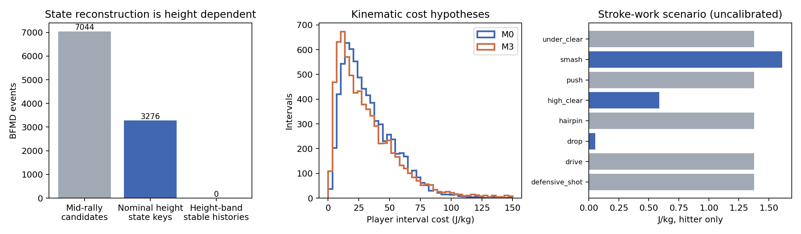

# BFMD 상태 복원 및 전체 전이의 양 선수 에너지 비용

## 1. 원인 / 하는 이유 / 개요

[Issue #2](https://github.com/lollipop190000/badminton_algorithm/issues/2)의 요청에 따라 새 주제 **10_transition_energy**를 추가했다. 기존 08은 착지 history가 없다는 이유로 모든 비용을 fallback으로 내보냈다. 이번에는 실제 BFMD 셔틀 주석을 읽고 복원 가능한 상태의 관측 운동학을 연결하며, 나머지 전이도 경기 분리 검증을 거친 계층적 추정으로 채운다. 01/04의 구획·상태 키·8타구·parity와 기존 Q/K/V 및 05/08 결과를 변경하지 않는다.

**계산 산출물은 완료됐다.** M0·M3 각각 **2,097,152행**, 합계 **4,194,304행**의 완전한 continuing 비용 Parquet를 제공한다. 다만 **BFMD 실제 착지 구획의 직접 검증은 완료되지 않았다.** 원 셔틀을 지면에 투영하면 완전 history는 1건뿐이고, 높이 추정으로 만든 3,276건은 ±0.45m에서 모든 네 구획이 안정적인 사례가 0건이다. 이들을 확정된 실제 착지 history로 부르지 않으며 모든 최종 행의 `state_reconstruction_imputed_flag=true`다. 8종 C_shot도 대사 실측값이 아닌 문헌·기계적 일 시나리오다. 따라서 요청의 “실제로 관측한 i,j”를 **정확한 실제 착지 상태**라는 엄밀한 뜻으로 해석하면 그 검증 조건은 아직 충족되지 않았다.

연구 범위는 C 완성이다. 최적 전략 추천, 정책 최적화, 경기 승률 개선 및 피로 인과효과를 구현하거나 검증하지 않았다.

## 2. 과정

### 입력·실행·의존관계

BFMD 단식 12경기의 96개 실제 JSON을 08의 고정 source ID/SHA256와 모두 대조했다. 셔틀·hit·court·프레임 court·bbox·pose·shot timeline·metadata를 읽었다. ShuttleSet/22의 pinned 원본 CSV도 01의 기록과 검증했다. 04 `transition_costs.parquet`의 전체 구조 키를 read-only 참조한다. 원자료·원영상·cache는 게시하지 않는다.

실행한 로컬 code 버전은 `89d47d7f99d976b7ec1623575a325fcf99eaac76`이고, 동일 계산 코드의 GitHub 게시 commit은 `533672a45af9add2d507a6a954ace7b923460930`이다. 실행 코드·설정 bytes의 SHA256 일치를 RUN에 기록했다. 실행 ID는 `20261014-complete-c-v2-kinggoddowon`이다. 실행 환경·seed·입력/설정/출력 해시는 [실행 기록](results/runs/20261014-complete-c-v2-kinggoddowon/RUN.json)에 있다. 최종 실행은 추출 재사용 없이 원 셔틀과 양 선수 궤적을 다시 계산했다.

```bash
python run.py transition-energy --download-missing --run-id 20261014-reproduction-yourname
python run.py exec -m unittest tests.test_transition_energy -v
python run.py test
python -m unittest discover -s tools/tests -v
python tools/update_manifest.py
python tools/check_repository.py
```

새 run_id로 실행한다. 기본 출력은 `.runtime/outputs/transition_energy/runs/<run_id>/`이고 검토 후 `python run.py sync-results`로 게시한다. [실행 설정](results/runs/20261014-complete-c-v2-kinggoddowon/executed_config.json) · [코드·함수·출력 설명](code/DETAILS.md) · [문헌 확인 및 미확보 상태](code/SOURCES.md).

### A. 셔틀 schema와 착지/접촉 대응

실제 `predictions[0].result[0].value.sequence`의 `frame,x,y,width,height,enabled`를 읽는다. 좌표는 percent, 중심은 `(x+width/2,y+height/2)`다. `_frame_indexing`은 “이미 -1 보정한 0-based decode order”이므로 다시 -1을 하지 않는다. TrackNet score/confidence field는 제공되지 않는다. 동일 frame의 중복, disabled, 큰 점프는 정상 관측값으로 쓰지 않는다. 양쪽 2프레임 이내의 관측으로만 보간하고 source와 gap을 기록한다. `coordinate_observed`도 TrackNet 예측이 제공됐다는 뜻이며 실제 위치 정답을 의미하지 않는다.

ShuttleSet 원본의 `landing[k]`와 같은 랠리 `hit[k+1]`를 비교했다. 전체 80,204쌍 중 좌표 78,278쌍, 양쪽 유효 구획 78,013쌍의 구획 일치율은 **99.997436%**다. 기존 연구 cohort에서는 57,421쌍 중 **99.996517%**다. 거리 중위수와 p95는 0m이다. 거의 같은 주석이라는 결과는 **주석 대응의 근거**이며 셔틀 높이를 무시해도 실제 지면 도착 좌표가 맞는다는 독립 검증이 아니다. [대응 요약](results/runs/20261014-complete-c-v2-kinggoddowon/shuttleset_correspondence.csv) · [전체 비교쌍](results/runs/20261014-complete-c-v2-kinggoddowon/shuttleset_landing_contact_pairs.parquet) · [구획 혼동표](results/runs/20261014-complete-c-v2-kinggoddowon/shuttleset_zone_confusion.csv).

BFMD의 공중 셔틀에 지면 homography를 그대로 적용하면 continuing 구획 1,356건과 4구획 history 1건만 유효하다. 추가로 court corners와 높이 1.55m의 net-post tops에서 수직 투영 열을 복원했다. 관측 셔틀 ray를 `1.8*(bbox_foot_y-shuttle_y)/bbox_height`로 추정한 높이 평면에 교차시킨다. 선수 발 좌표로 셔틀을 교체하지 않고 코트 안으로 강제 clipping하지 않는다. 선수 높이·bbox 스케일·수직 열 transport는 가정이다. ±0.45m 구획 시나리오를 저장했으며 이 구간은 실제 95% CI가 아니다. [실제 schema/기하 감사](results/runs/20261014-complete-c-v2-kinggoddowon/shuttle_schema_audit.json) · [높이 민감도](results/runs/20261014-complete-c-v2-kinggoddowon/height_projection_sensitivity.csv) · [상태 불확실성 선언](results/runs/20261014-complete-c-v2-kinggoddowon/state_uncertainty.json).

### B. 운동학 비용과 beta

각 선수의 `[t_k,t_(k+1))` 구간을 한 번만 적분한다. 08의 `bw3` 평활화, bbox 지면 proxy·pose presence·court gate를 재사용해 새로 계산했다. 결측 tracking을 정지나 비용 0으로 바꾸지 않는다. L, Xv, X±, Xc, 이동시간, 경로길이, 직선변위, 속력·접선/법선 가속도 통계를 보존한다.

$$C_{movement,M0}=19.985L$$

$$C_{movement,M3}=19.985\frac{L+\beta_vX_v+\beta_+X_++\beta_-X_-+\beta_cX_c}{1+\boldsymbol\beta^T\boldsymbol\mu}$$

train 완전 관측 5,035개 선수 구간만으로 `v0=3.049290 m/s`, `mu=(1.000000, 0.739488, 0.709195, 0.322652)`를 구했다. validation/test는 mu·v0 계산에 사용하지 않는다. M0가 **대표 이동모형**이다. M3 `(0,1,0.25,0.6234)`는 양의 가속·상대적으로 작은 제동·곡률 힘 비용을 살펴보는 가설이다. 0.6234는 지속 곡선 달리기 연구의 힘 기반 모양을 참고했다. 절대 가감속 계수는 대사 정답에서 피팅하지 않았다.

Pugliese의 거리당 비용을 이미 여러 방향 풋워크에서 얻었으므로 M3는 **정규화한 재배분 가설**이다. 분모가 문헌 기계적 계수의 절대 해석을 바꾸고, 방향전환 연구가 감속/재가속을 포함할 수 있어 X±와 Xc의 중복 가능성이 남는다. Zago의 검증된 3D/지면접촉 제동 알고리즘을 재현했다거나 beta를 최적화했다고 주장하지 않는다. [train 정상화](results/runs/20261014-complete-c-v2-kinggoddowon/normalization.json) · [beta별 분포·순위 민감도](results/runs/20261014-complete-c-v2-kinggoddowon/beta_sensitivity.csv).

### C. 8타구 비용과 포함 결정

라켓 기계적 일 시나리오는 `E_racket=0.5*I*(v_head/lever)^2`이고, J/kg 비용은 `E_racket/mass*(1/eta_positive+1/|eta_negative|)*multiplier`다. 기준 I=0.00955kg·m², lever=0.5m, mass=68.6kg, efficiency=(0.25,1.2), multiplier=1이다. 단위 변환 `1 kg·cm²=0.0001 kg·m²`를 적용했다.

Phomsoupha Table 1의 drop/clear/smash head speed 6.3/20.9/34.6m/s를 그 3종의 시나리오에 사용했다. 나머지 5종은 직접 대응하는 자료가 없어 측정 4종(추가 full smash 49.2m/s)의 **동일 가중 평균 기계적 일 prior**를 사용했다. 5종의 경험적 서열을 임의로 정하지 않았다. 높은 pooled 가정이 hairpin/defensive 계열의 실제 부담과 같다는 뜻은 아니다. head speed, inertia와 효율을 서로 다른 조건에서 결합했고 팔/몸통·force-rate·점프 부담은 식별되지 않았다. 라켓 운동에너지와 실제 스윙 대사에너지를 동일시하지 않는다.

사전에 전체 기여 1% 미만이며 95% 이상 완전 관측 선수 랠리에서 기여 5% 미만일 때만 생략을 검토했다. 상한 **시나리오**로는 M0 197개 선수 랠리의 합계 기여가 42.4563%, 5% 미만 랠리 비율은 14.7208%여서 무시 가능하다는 조건을 통과하지 못했다. M3도 같은 결론이다. 따라서 **타구비용을 추정 시나리오로 포함**한다. 이것은 실제 부담이 42%라는 결론이 아니다. 넓은 미확정 범위를 이유로 작은 비용이라고 확정하지 않은 것이다. [포함 결정](results/runs/20261014-complete-c-v2-kinggoddowon/shot_inclusion_decision.csv) · [선수별 랠리 누적량 민감도](results/runs/20261014-complete-c-v2-kinggoddowon/rally_cost_sensitivity.parquet).

### D. 추정·검증·호환성

08의 경기 단위 train8/validation2/test2를 유지했다. 새 main의 [09 전달 추정 방법](../09_cost_transfer_method/REPORT.md)은 별도 방법론으로 보존했으며, 이 주제는 요청한 셔틀 상태 복원과 완전 C 산출을 담당한다. train에서 role/shot/거리/현재·다음 도착 구획/부분 history/exact 계층을 비교하고 validation의 M0/M3 train-SD 정규화 RMSE 평균으로 선택했다. 선택된 계층은 `global → role → role+shot → z3+role+shot → z3+next_zone+role+shot → exact`이며 tau=5다. 작은 exact 표본을 local 평균으로 확정하지 않는다. 최종 그룹 평균은 train+validation만 사용한다. Test의 591개 완전 운동학·복원 구간은 최종 fit에서 제외됐다.

[선택 grid](results/runs/20261014-complete-c-v2-kinggoddowon/validation_grid.csv) · [exact 수축 추가 검증](results/runs/20261014-complete-c-v2-kinggoddowon/exact_augmentation_validation.csv) · [선택된 추정기](results/runs/20261014-complete-c-v2-kinggoddowon/selected_estimator.json) · [held-out 오차](results/runs/20261014-complete-c-v2-kinggoddowon/test_comparison.csv) · [최종 선택 모형의 전체 test 예측](results/runs/20261014-complete-c-v2-kinggoddowon/test_predictions.parquet).

개발 자료의 exact 그룹 433개를 통째로 가린 451개 관측에서 M0 MAE/RMSE는 10.247757/13.515212 J/kg, M3는 12.684643/18.073204 J/kg이다. [미관측 상태 마스킹 검증](results/runs/20261014-complete-c-v2-kinggoddowon/masked_state_validation.csv). 이 오차는 추적 데이터에서 계산한 비용 pseudo-label에 대한 내부 예측 오차다. 실제 착지 또는 대사 정확도를 평가한 것이 아니다.

100회 경기 bootstrap으로 고정 설정의 조건부 평균 95% percentile CI를 구했다. tracking/높이/beta/shot 시나리오/도메인 이동의 불확실성을 그 CI에 포함했다고 주장하지 않는다. 복원한 키의 비용 관측 수를 `n_exact`로 저장하지만 실제 착지 상태의 정답 표본 수는 미확보다. 원 conditional mean과 분산·경기 수는 [수축 전 상태별 관측 평균](results/runs/20261014-complete-c-v2-kinggoddowon/exact_conditional_means.parquet) 및 [원 픽셀·높이 안정성 근거](results/runs/20261014-complete-c-v2-kinggoddowon/exact_state_evidence.parquet)에 있다.

원 Q의 키 1,048,576개를 직접 읽고 전체 키별 uniqueness/sliding/parity를 확인했다. [adapter](code/src/transition_energy/adapter.py)는 A/B C tensor를 `[r,i,s,next_zone-1]`로 로드한다. 기존 solver를 임의로 변경하지 않는다. 비용은 관측 조건부 평균이며 `do(s)`의 인과효과가 아니다.

마지막 타구에는 continuing j가 없다. 직전 구간 이동은 이전 continuing 전이에서 한 번 부과하고 terminal은 마지막 타격 비용만 더한다. 임의 outgoing 이동을 생성하지 않는다. 전체 terminal lookup 131,072행과 실제 1,053개 terminal 타구의 양 선수 비용을 별도 제공한다. 5개 metadata 랠리는 inferred hit가 없어 그 마지막 타격을 관측했다고 주장하지 않는다. 원 8타구 밖의 service/미매핑 terminal은 지원 여부를 표시한다. [모든 terminal 상태 비용](results/runs/20261014-complete-c-v2-kinggoddowon/terminal_lookup.parquet) · [실제 terminal 이벤트 처리](results/runs/20261014-complete-c-v2-kinggoddowon/terminal_costs.parquet).

05의 예산을 적용하려면 새 convention의 이벤트 누적량·예산 분위수·종료모형을 일관되게 재산정해야 한다. 이번 matched 표본의 기존 conditional distance prior 대비 새 이동비용 합계 비율은 M0 A=1.120339/B=1.165868, M3 A=1.081139/B=1.116196이다. 이것을 모든 예산에 곱할 고정 환산계수로 쓰지 않는다. [예산 재산정 영향 비교](results/runs/20261014-complete-c-v2-kinggoddowon/budget_recalibration.csv) 및 [누적량 함수·적용 설명](code/DETAILS.md).

## 3. 결과

### 상태와 운동학 관측

| 항목 | 실제 실행 수치 |
|---|---:|
| 단식 경기 / 원본 주석 파일 | 12 / 96 |
| 타구 이벤트 / terminal | 11,301 / 1,053 |
| Continuing 타구 / 8타구 mid-rally 후보 | 10,248 / 7,257（랠리 QC 통과 7,044） |
| 관측 / 보간 / 미확보 좌표 이벤트 | 10,311 / 373 / 617 |
| 높이 시나리오로 i,j를 구성한 8타구 전이 | 3,276 |
| 위 history의 픽셀 모두 관측 / 일부 보간 | 2,949 / 327 |
| ±0.45m에서 네 구획이 모두 안정적인 history | **0** |
| 선수별 이동 구간 / L-valid / 모든 X-valid | 19,922 / 10,056 / 9,813 |
| 복원 상태+L-valid / 모든 X-valid 선수 구간 | 3,737 / 3,645 |
| 08 운동학과 새 계산의 최대 절대 차이 | 1.8474e-13 |
| 독립 영상/3D 기준의 착지 오분류율 | **미확보** |

[전체 지표](results/runs/20261014-complete-c-v2-kinggoddowon/metrics.json) · [타구별 복원·관측·품질 전체](results/runs/20261014-complete-c-v2-kinggoddowon/reconstructed_events.parquet) · [양 선수 운동학 전체](results/runs/20261014-complete-c-v2-kinggoddowon/movement_observations.parquet) · [08 재계산 일치 확인](results/runs/20261014-complete-c-v2-kinggoddowon/fresh_vs_08_kinematics.csv).

### 완전한 C와 추정 출처

| model | method | n | fraction |
| --- | --- | --- | --- |
| M0 | fallback | 2094178 | 0.998582 |
| M0 | exact_shrinkage | 2974 | 0.001418 |
| M3 | fallback | 2094241 | 0.998612 |
| M3 | exact_shrinkage | 2911 | 0.001388 |

M0 exact 비용 지원 **2,974개 선수 키(0.141811%)**, M3 **2,911개(0.138807%)**다. 최종 tau=5이므로 이들도 exact shrinkage로 표시한다. **수축 없는 직접 최종 비용 행은 0개, imputed 비용 행은 모델당 2,097,152개**다. 이것은 상태별 비용 관측이 전혀 없다는 뜻이 아니다. 수축 전 관측 평균은 별도 보존했다. 미관측 fallback에 0을 넣지 않았다.

[M0 전체 2,097,152행](results/runs/20261014-complete-c-v2-kinggoddowon/C_M0.parquet) · [M3 전체 2,097,152행](results/runs/20261014-complete-c-v2-kinggoddowon/C_M3.parquet) · [누락·중복·키·단위 검증](results/runs/20261014-complete-c-v2-kinggoddowon/complete_table_audit.json) · [fallback·수축·CI parameter 전체](results/runs/20261014-complete-c-v2-kinggoddowon/prediction_parameters.parquet).

| model | player | n | movement_mean | total_mean | movement_p05 | movement_p50 | movement_p95 |
| --- | --- | --- | --- | --- | --- | --- | --- |
| M0 | A | 1048576 | 32.989505 | 33.560726 | 15.177171 | 29.594589 | 60.225152 |
| M0 | B | 1048576 | 32.989446 | 33.560667 | 15.177171 | 29.594589 | 60.225152 |
| M3 | A | 1048576 | 32.764034 | 33.335254 | 12.992683 | 30.082660 | 66.564332 |
| M3 | B | 1048576 | 32.763939 | 33.335160 | 12.992683 | 30.082660 | 66.564332 |

위 평균은 모든 구조 키에 동일 가중치를 준 lookup 요약이며 실제 경기 방문빈도 가중 대사비용이 아니다. 실제 조건부 관측 분포는 [split/role/shot별 관측 요약](results/runs/20261014-complete-c-v2-kinggoddowon/observed_cost_summary.csv)에 따로 있다.

### Held-out 비용 예측과 beta 민감도

| chain | model | n | mae | rmse |
| --- | --- | --- | --- | --- |
| role_shot | M0 | 591 | 10.888207 | 13.984097 |
| role_shot | M3 | 591 | 13.232307 | 17.586402 |
| distance_role_shot | M0 | 591 | 10.204488 | 13.466561 |
| distance_role_shot | M3 | 591 | 12.227362 | 16.934198 |
| arrival_pair_plus_exact | M0 | 591 | 10.110248 | 13.555868 |
| arrival_pair_plus_exact | M3 | 591 | 12.253963 | 17.073664 |

Validation으로 선정한 도착 구획 계층이 test에서 모든 후보보다 좋지는 않다. 예를 들어 M0 test RMSE는 거리 후보가 약 13.47로 더 작다. test를 보고 모형을 다시 선택하지 않았다. 비용 pseudo-label 오차와 물리적 정확도를 구별해야 한다.

| beta_config_id | mean_J_per_kg | p95_J_per_kg | rank_correlation_to_M0 |
| --- | --- | --- | --- |
| M3_unit_accel_curve_hypothesis | 32.869645 | 82.629710 | 0.974072 |
| beta0 | 33.273801 | 72.980196 | 1.000000 |
| acceleration_only | 32.866942 | 81.729809 | 0.973657 |
| curve_only | 33.210434 | 77.123155 | 0.991906 |
| prior_example | 32.740880 | 86.662752 | 0.959853 |
| half | 32.999268 | 79.444770 | 0.986566 |
| double | 32.744746 | 87.600968 | 0.959543 |

완전 관측 mid-rally **7,206개**의 M0 평균은 **33.273801 J/kg**, M3는 **32.869645 J/kg**이다. 각 beta의 train 거리당 평균은 정규화 때문에 모두 19.985이므로 이 일치를 외부 대사 검증으로 쓰지 않는다. 반대로 일부 interval 비용과 순위는 beta에 따라 달라진다.

### 타구별 최종 시나리오

| s | C_shot_J_per_kg | scenario_low_J_per_kg | scenario_high_J_per_kg |
| --- | --- | --- | --- |
| defensive_shot | 1.377449 | 0.003440 | 48.417400 |
| drive | 1.377449 | 0.003440 | 48.417400 |
| drop | 0.053412 | 0.003440 | 1.232642 |
| hairpin | 1.377449 | 0.003440 | 48.417400 |
| high_clear | 0.587826 | 0.088770 | 10.232459 |
| push | 1.377449 | 0.003440 | 48.417400 |
| smash | 1.611047 | 0.425352 | 42.635065 |
| under_clear | 1.377449 | 0.003440 | 48.417400 |

하한/상한은 지정 가정 시나리오이며 통계적 신뢰구간이나 실제 생리학적 bound가 아니다. 상대 선수에는 각 행의 C_shot을 0으로 부과한다. M0/M3에 동일한 shot 규칙을 적용했다.

| s | hitter_movement_mean_J_per_kg | ratio_to_hitter_mean | upper_ratio_to_hitter_mean |
| --- | --- | --- | --- |
| defensive_shot | 21.347742 | 0.064524 | 2.268034 |
| drive | 18.043852 | 0.076339 | 2.683318 |
| drop | 30.672925 | 0.001741 | 0.040187 |
| hairpin | 21.641240 | 0.063649 | 2.237275 |
| high_clear | 47.970156 | 0.012254 | 0.213309 |
| push | 24.084038 | 0.057193 | 2.010352 |
| smash | 24.474585 | 0.065825 | 1.742014 |
| under_clear | 43.287344 | 0.031821 | 1.118512 |

[8타구 설정·근거](results/runs/20261014-complete-c-v2-kinggoddowon/shot_costs.csv) · [M0/M3 평균·중위수·분위수 및 shot 비율](results/runs/20261014-complete-c-v2-kinggoddowon/shot_movement_scale.csv).



### 완료 판정과 남은 검증

1. **대표 이동모형은 M0**이며 M3도 전체 보존한다.
2. **M3 beta=(0,1,0.25,0.6234)**다. 문헌의 비용 방향과 가정 민감도에 근거한 비교 가설이며 최적 대사 계수가 아니다.
3. **C_shot은 포함**한다. 넓은 미확정 범위에서 무시 가능 기준을 통과하지 못했으며 실제 타구 대사 정답으로 검증하지 않았다.
4. 8종 C_shot은 위 표와 같고, 측정 head speed를 확보한 3종과 pooled prior 5종을 구별한다.
5. 모든 유효 continuing `(i,j,r,s)`에 대해 A/B C를 **결측 없이 계산**했다. 각 모델 2,097,152행이다. 별도 terminal lookup도 제공한다.
6. 비용 관측에 연결된 계산상 exact 선수 키는 M0 2,974/M3 2,911개이며 모두 수축했다. **실제 착지 상태의 독립 정답 관측은 미확보**, 전체 비용은 이 상태 및 대사 가정의 불확실성을 가진다.
7. 실제 셔틀 픽셀·양 선수 운동학·문헌 기반 함수·경기 분리·마스킹·bootstrap·전체 키 검증과 재현 코드를 제공했다. 높이 보정의 독립 영상/3D 검증, 8종 타구 respirometry, 경기 비용 보정은 남아 있다. 요청의 정확한 직접 착지 복원 조건을 충족했다고 과장하지 않는다.

저장소의 기존 과학적 감사 기록은 다시 작성하지 않았다. 새 코드/결과/설정/문서는 이 주제와 root 목차·실행 연결·manifest에만 추가한다. main 직접 push/자동 병합은 하지 않고 개인 브랜치 PR로 제출한다.

### 게시 전 검사

최신 main의 09 주제를 보존한 상태에서 연구 테스트 **82개**, 협업 검사 **6개** 통과. 이전 01/04/05/08 파일 **226개**의 SHA256가 baseline과 모두 동일하다. [검사 실행 로그](results/runs/20261014-complete-c-v2-kinggoddowon/verification.txt) · [보호 입력·결과 해시 확인](results/runs/20261014-complete-c-v2-kinggoddowon/protected_inputs_unchanged.json). 파일당 50MiB 제한과 REPORT 상대 링크·문법·실행 ownership·manifest를 검사했다.

### 중단 후 복구·게시 재개

기존 계산 결과를 재생성하지 않고 최신 main `3c195ea5656c831492834bda626dc042968d388c`를 반영했다. 기존 결과 42개의 기록 SHA256가 모두 일치하며 비용표 전수 검사에서 M0/M3 각 2,097,152행, 중복·결측 없는 상태 키, 비음수 유한 비용, parity 및 타격자 비용 계약을 확인했다. 기존 01~09 주제 파일 **374개**가 최신 main과 동일하다. 연구 테스트 **89개**, 협업 검사 **6개** 통과. 기존 게시 전 검사 82개/226개는 이전 baseline에 대한 당시 기록으로 보존한다.

[복구 경위·확인 불가 원인](results/runs/20261014-recovery-verification-kinggoddowon/RECOVERY.md) · [보존된 파일 전체 목록](results/runs/20261014-recovery-verification-kinggoddowon/preserved_file_inventory.csv) · [전수 검사](results/runs/20261014-recovery-verification-kinggoddowon/audit.json) · [복구 검증 RUN](results/runs/20261014-recovery-verification-kinggoddowon/RUN.json).

재검사 명령: `python 10_transition_energy/code/scripts/verify_transition_energy.py --run 10_transition_energy/results/runs/20261014-complete-c-v2-kinggoddowon --baseline 3c195ea5656c831492834bda626dc042968d388c`. 이 명령은 원 결과를 읽기 전용으로 검사한다.
