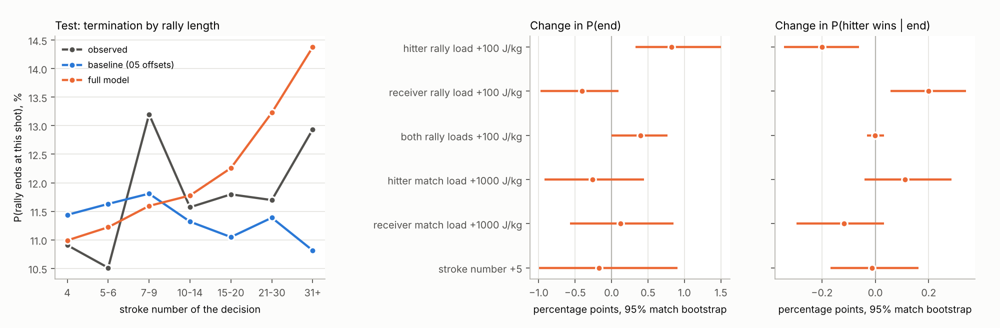

# 13. 구조적 체력 모형: 종료 위험과 승패를 나누고 합·차 부하, 랠리 길이, 경기 누적·회복 반영

## 1. 원인 / 하는 이유 / 개요

[05의 고정 Q 체력 모형](../05_energy_budget/REPORT.md)과 [12의 M0_v2 재적합](../12_integrated_stamina_refit/REPORT.md)은 **종료 타구의 승패 배분**만 체력 함수로 둔다. 구조상 네 가지 문제가 있다.

1. 종료 확률 `T0 = w0 + l0`가 고정되어 있다. 그래서 체력이 랠리를 **끝내는** 효과를 볼 수 없고, 적합에는 종료 타구 3,392개만 쓰고 비종료 결정 약 26,000개는 버린다.
2. 타구자 누적 `D_H`와 리시버 누적 `D_R`의 상관이 0.98이라 두 기울기를 따로 추정하기 어렵다.
3. 누적 부하는 타수와 거의 같은 정보다. 따라서 "긴 랠리라서 생기는 효과"(전술·상황)와 체력 효과가 섞인다.
4. 매 랠리를 0에서 시작하므로 경기 전체의 누적 피로와 랠리 사이 회복이 없다.

12의 시험 결과도 개선이 없었다(절편 모형 0.561224 대비 +0.004).

이 주제는 [11의 M0_v2 이동비용과 타구 비용](../11_integrated_transition_energy/REPORT.md)을 12와 똑같은 방식으로 누적하고, 위 네 가지를 모두 고친 **2단계 전이 모형**을 세운다. 기준은 05의 역할 통합 기준표 `p0`이며, 이를 고른 샷 기준 조건부 확률로 바꿔 쓴다.

```math
\operatorname{logit} P(\text{end}) = \operatorname{logit} T_0 + a^E_s + \theta_E^{\top} f,\qquad
\operatorname{logit} P(\text{hitter wins}\mid\text{end}) = \log\frac{W_0}{L_0} + a^W_s + \theta_W^{\top} f,\qquad
Q(j) = \bigl(1-P(\text{end})\bigr)\,\frac{Q_0(j)}{\sum_k Q_0(k)}
```

특징 `f`는 모두 타구자 관점이다. 그래서 A·B 역할을 바꿔도 같은 모형이 된다(parity 대칭).

| 묶음 | 특징 | 고치는 문제 |
|---|---|---|
| 길이 | `log(k/4)`, `max(log(k/8),0)`, `max(log(k/16),0)`, k = 타구 번호 | 3 |
| 랠리 부하 | `S = (D_H+D_R)/2/100`, `Δ = (D_H−D_R)/100` (J/kg) | 2 (합·차로 재매개화) |
| 경기 부하 | `S_m = (G_H+G_R)/2/1000`, `Δ_m = (G_H−G_R)/1000`, `G = Σ 이전 랠리 부하 · exp(−Δt/τ)` | 4 |
| 세트 | 2세트, 3세트 지시변수 | 4 |
| 종료 위험 단계 | 모든 결정에 위 특징 적용 | 1 |

검증할 가설은 네 가지다.

- (H1) 합·차 재매개화로 공선성이 사라진다.
- (H2) 길이를 통제한 뒤에도 랠리 부하가 종료 위험과 승패를 설명한다.
- (H3) 회복을 가중한 이전 랠리 부하에 추가 설명력이 있다.
- (H4) 전체 구조가 시험 예측을 개선한다.

## 2. 과정

- **입력**
  - [01 통합 타구 CSV](../01_data_16zone/results/processed/merged_elite_QF_SF_F.csv): 91경기, 5,888랠리, 63,410타. 영상 시계 `time_s`를 쓴다.
  - [01 분할](../01_data_16zone/results/splits/)의 train, validation, test CSV.
  - [11 전달 모형](../11_integrated_transition_energy/results/runs/20261104-integrated-v2-kinggoddowon/transfer_models.json)과 [타구 비용](../11_integrated_transition_energy/results/runs/20261104-integrated-v2-kinggoddowon/shot_costs.csv).
  - [05 기준표 train](../05_energy_budget/results/fatigue_terminal/baseline_train.npz)과 [train+validation](../05_energy_budget/results/fatigue_terminal/baseline_final.npz), [기준 선택](../05_energy_budget/results/fatigue_terminal/baseline_selection.json).
- **출력**: `results/runs/<run_id>/`에 아래 파일을 쓴다.
  - 지표: `metrics.csv`, `selection_grid.csv`, `test_paired_intervals.csv`
  - 계수와 효과: `coefficient_intervals.csv`, `variant_coefficients.csv`, `marginal_effects.csv`
  - 보정과 원자료: `calibration_by_stroke.csv`, `decision_predictions.csv`, `rally_loads.csv`
  - 모형: `model_development.json`(train), `model_final.json`(train+validation)
  - 기록과 그림: `audit.json`, `config.json`, `figure_structural_fatigue.png`, `RUN.json`
- **의존관계**: 04의 결정 사건과 parity, 05의 기준표, 11의 비용 함수, 12의 `attach_costs`를 **수정 없이** 불러 쓴다. Q의 도착 분포, 비용표, 기존 결과는 바꾸지 않는다.
- **재현 명령**: 저장소 루트에서 `python 13_structural_fatigue_model/code/scripts/run_structural_fatigue.py --run-id <YYYYMMDD-description-author>`를 실행한다.
  - 설정: [code/configs/structural_fatigue.json](code/configs/structural_fatigue.json). seed 20261105, 기준 fold seed 42.
  - 13 코드가 커밋되지 않았으면 실행을 거부한다.
  - 테스트: `python run.py exec -- -m unittest tests.test_structural_fatigue -v`
- **방법**
  - **표본**
    - 05·12와 같은 결정 사건을 쓴다: train 30,116, validation 7,459, test 6,967.
    - 프레임 순서가 불확실한 랠리는 제외한다. 승자가 기록되지 않은 종료는 적합에서 뺀다.
    - 적합 결정: 29,798 / 7,383 / 6,960. 종료: 3,392 / 753 / 816. 종료 수는 12와 같다.
  - **기준 offset**
    - 05 `probability`는 결합확률 P(샷, 결과 | 상태)다. 각 (상태, 샷) 행을 P(샷 | 상태)로 나눠 샷 조건부로 만든다.
    - train 행은 05와 같은 규칙(경기 정렬 → `default_rng(42)` 순열 → 5묶음)으로 **교차 적합**해, 자기 경기의 빈도를 보지 않게 한다.
    - validation과 test는 공개된 train 기준표를 그대로 쓴다.
  - **경기 부하**
    - 이전 랠리 총부하를 영상 시계 간격으로 감쇠해 더한다.
    - 01에서 빠진 랠리(`rally_local` 공백 1,769개)는 시계 공백 안에 고르게 놓고 train 평균 랠리 부하(399 J/kg)를 **두 선수에게 똑같이** 넣는다. 그래서 대체값은 합 `S_m`에만 들어가고 차 `Δ_m`에는 들어가지 않는다. 대체하지 않은 민감도 분석도 함께 한다.
  - **변형과 선택**
    - `offset_only`, `shot`, `rally_unadjusted`(길이 없음), `length`, `rally`, `match`, `full`을 비교한다.
    - `full`은 사전에 정한 주 모형이고 나머지는 절제(ablation) 비교다.
    - ridge는 train 표준화 특징에 걸며 샷 절편도 포함한다. 격자는 0–10이다.
    - 두 단계는 우도가 분리되므로 ridge를 단계별로 고른다. 회복 시간 τ ∈ {30, 60, 120, 300, 600, 1200 s, ∞}는 두 단계가 공유한다.
    - 선택에는 validation만 쓴다.
  - **평가와 불확실성**
    - test는 고정된 적합으로 한 번 평가한다. 지표는 결정당 종료 위험 로그손실, 종료당 승패 로그손실, 둘을 합친 결정당 로그손실이다.
    - test 차이는 경기 단위 paired bootstrap(15경기, 1,000회)으로 구한다.
    - 계수와 한계효과 구간은 train 경기 bootstrap(200회)으로 구한다. offset, τ, ridge는 고정한다.
    - 배포 모형은 train+validation 교차 적합 offset과 `baseline_final`로 다시 적합한다.
  - **검사**
    - 직접 센 기준표가 `baseline_train`·`baseline_final`과 최대 차이 0으로 같다.
    - `offset_only`의 validation 전체 사건 로그손실이 05 공개값 3.335723730059288과 같다.
    - 배포 전이 `Q + w + l`의 질량 보존 오차는 3.3e-16이다.

## 3. 결과

실행 기록은 [RUN.json](results/runs/20261105-structural-fatigue-m0v2-claude/RUN.json)이다(code commit 651b8a8, 입력·설정·출력 SHA256). 모든 지표는 해당 run 파일에서 옮겼다.

| 지표 / 단위 | 기준선 (`offset_only` = 05 기준표) | 이번 결과 (`full`) | 표본 수 / 구간 | 실제 산출물 |
|---|---:|---:|---|---|
| test 결합 로그손실 / 결정 | 0.407843 | 0.407719 | 6,960결정, 차이 −0.00012 [−0.00110, 0.00089] | [metrics](results/runs/20261105-structural-fatigue-m0v2-claude/metrics.csv) · [paired](results/runs/20261105-structural-fatigue-m0v2-claude/test_paired_intervals.csv) |
| test 종료 위험 로그손실 | 0.342017 | 0.341871 | 6,960, −0.00015 [−0.00114, 0.00085] | 같은 파일 |
| test 승패 로그손실 | 0.561456 | 0.561647 | 816, +0.00019 [−0.00018, 0.00070] | 같은 파일 |
| validation 결합 로그손실 / 결정 | 0.374226 | 0.373737 | 7,383 (선택에 사용) | [metrics](results/runs/20261105-structural-fatigue-m0v2-claude/metrics.csv) |
| 부하 공선성: 상관 → VIF | corr(D_H, D_R) 0.980 | VIF(Δ) 1.02 | train 29,798결정 | [audit](results/runs/20261105-structural-fatigue-m0v2-claude/audit.json) |
| 선택된 회복 시간 τ | — | ∞ (회복 없음) | τ ≤ 120 s에서는 두 단계 모두 ridge 최대(효과 0)를 선택 | [grid](results/runs/20261105-structural-fatigue-m0v2-claude/selection_grid.csv) |
| 타구자 랠리 부하 +100 J/kg → P(종료) | 0 | +0.83 %p [0.33, 1.50] | 기준 11.4%, train | [한계효과](results/runs/20261105-structural-fatigue-m0v2-claude/marginal_effects.csv) |
| 타구자 랠리 부하 +100 J/kg → P(타구자 승 \| 종료) | 0 | −0.20 %p [−0.34, −0.06] | 기준 35.4%, 3,392종료 | 같은 파일 |
| 2세트 · 3세트 종료 위험 (logit) | 0 | +0.20 [0.09, 0.29] · +0.34 [0.13, 0.52] | train 경기 bootstrap 200 | [계수](results/runs/20261105-structural-fatigue-m0v2-claude/coefficient_intervals.csv) |
| 경기 누적 합 S_m (logit / 1000 J/kg) | 0 | −0.014 [−0.020, −0.008] | 같음 | 같은 파일 |
| 배포 전이 질량 보존 오차 | — | 3.3e-16 | validation+test 결정 | [audit](results/runs/20261105-structural-fatigue-m0v2-claude/audit.json) |



**H1 (합·차 재매개화) — 확인.** `D_H`와 `D_R`의 상관은 0.980이었지만, 차 `Δ`의 VIF는 1.02로 다른 모든 특징과 거의 직교한다. 반면 합 `S`의 VIF는 21이다. 랠리 길이와의 상관이 0.92–0.96이기 때문이다(문제 3이 실제로 있다는 뜻). 재매개화는 같은 공간을 다르게 표현하는 것이라 벌점이 없으면 적합값이 같고, 해석과 수치 안정성만 바뀐다.

**H2 (길이 통제 후 랠리 부하) — 학습 표본에서는 연관, 검증에서는 재현되지 않음.**

- 주 모형에서 타구자가 리시버보다 100 J/kg 더 썼을 때 종료 위험은 +0.83 %p, 종료 시 타구자 승률은 −0.20 %p였다(train 경기 bootstrap 구간이 0을 제외).
- 하지만 경기 부하 없이 길이와 랠리 부하만 쓴 `rally` 변형에서는, validation이 종료 위험 단계의 ridge를 최대값(사실상 효과 0)으로 골랐다.
- 길이별 보정을 보면 train에서는 31타 이상의 종료율이 14.8%로 기준표(11.0%)보다 높았다. 그러나 validation에서는 9.8%, test에서는 12.9%였다([보정표](results/runs/20261105-structural-fatigue-m0v2-claude/calibration_by_stroke.csv)). 주 모형은 이 긴 랠리 증가를 따라가므로 validation·test의 긴 랠리 종료율을 과대예측한다(그림 왼쪽).

**H3 (경기 누적·회복) — 체력 회복 신호는 없음.**

- 짧은 회복(τ ≤ 120 s, 직전 몇 랠리의 부하)은 validation에서 아무것도 설명하지 못했다.
- 선택된 τ = ∞는 "지금까지 경기에서 쓴 총부하"이므로 사실상 **경기 진행도**다.
- 종료 위험에서는 세트 안에서 누적이 늘면 조금 낮아지고(S_m 음수), 2·3세트에서 높아졌다. 이 형태는 피로보다 세트·점수 상황 같은 경기 맥락과 더 잘 맞는다.
- 두 선수의 경기 누적 상관은 0.998이라 차 `Δ_m`의 변동이 작고, 구간도 0을 포함했다.
- 빠진 랠리를 대체하지 않아도 결과가 거의 같았다(test 결합 0.408016 대 0.407719).

**H4 (예측 개선) — 확인되지 않음.** test 결합 로그손실 차이는 기준표 대비 −0.00012 [−0.00110, 0.00089], 샷 절편 모형 대비 −0.00010 [−0.00108, 0.00088]로 둘 다 0을 포함한다. 승패 단계는 validation이 강한 ridge(1.0)를 골라 계수가 크게 줄었다. 12와 같은 결론이다. **11의 M0_v2 추정 소모량만으로는, 구조를 고쳐도 05 기준표 이상의 전이 예측력이 test에서 확인되지 않는다.**

**해석과 한계**

- 모든 효과는 관측 경기에서 나온 **연관**이다. 체력의 인과효과가 아니다.
- 타구자 상대 부하 `Δ`가 크다는 것은 체력 저하일 수도 있지만, 많이 끌려다닌(수세) 상황을 뜻할 수도 있다. 상태 i(직전 3 착지)가 이를 일부만 통제한다.
- 부하는 11의 이동·타구 비용 추정치다. 실측 대사에너지나 남은 생리적 체력이 아니다.
- 빠진 랠리 중 세트의 마지막 관측 랠리 이후에 빠진 것은 찾지 못한다.
- test 분할은 05·12에서 이미 평가한 경기이고, 15경기라 구간이 넓다.
- 계수 bootstrap은 offset, τ, ridge, 비용표를 고정한 조건부 구간이다.
- Q의 도착 분포는 기준표 그대로이고, 체력은 종료와 승패로만 들어간다.

**사용법과 후속 영향**

`model_final.json`은 `StructuralFatigueTransition`으로 불러 `transition(state, parity, shot, stroke_no, D_A, D_B, G_A, G_B, set_id)`를 호출하면 된다. 반환값은 `Q[16]`, `w_A`, `l_A`이며 행 합이 1이다. `joint=True`로 호출하면 05 `probability`와 같은 결합 척도(행 합 = P(샷 | 상태))가 된다.

이 모형을 V·K에 넣으려면 05 에너지 전략처럼 상태에 (D_A, D_B, 타수, 경기 부하)를 더해야 한다. 이번 주제에서는 그 계산을 실행하지 않았다. 기존 01–12의 결과는 삭제하거나 대체하지 않았다.
