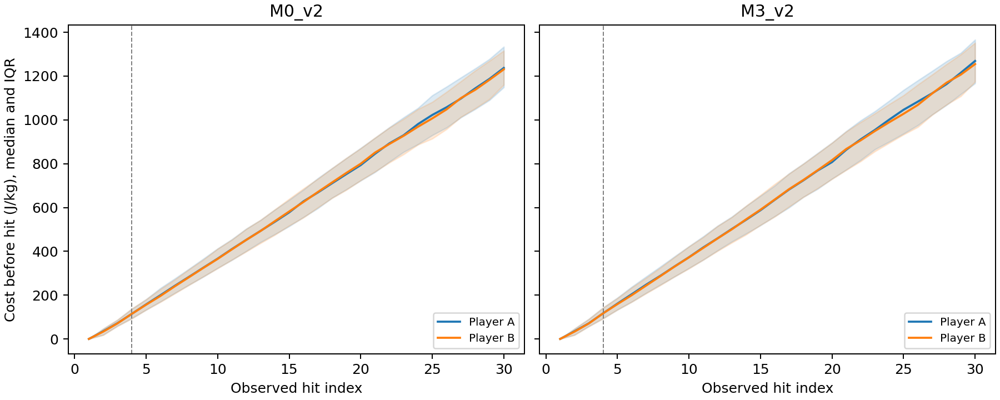
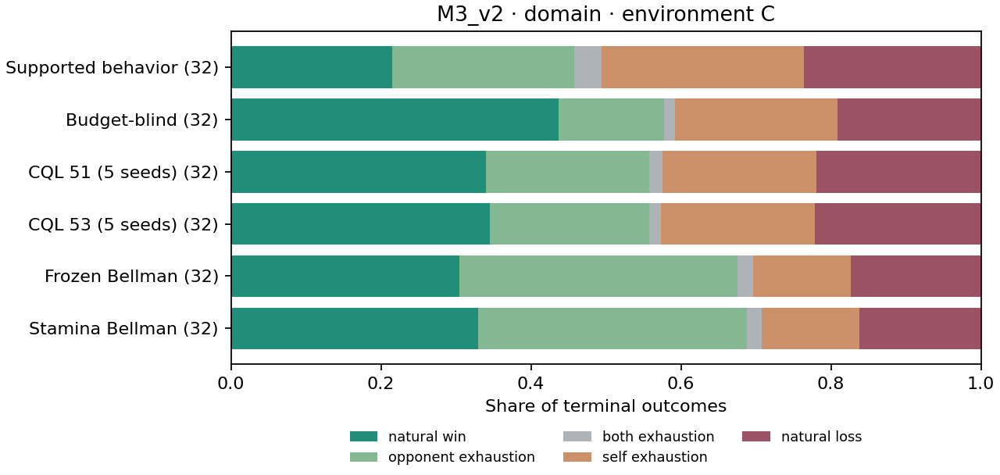
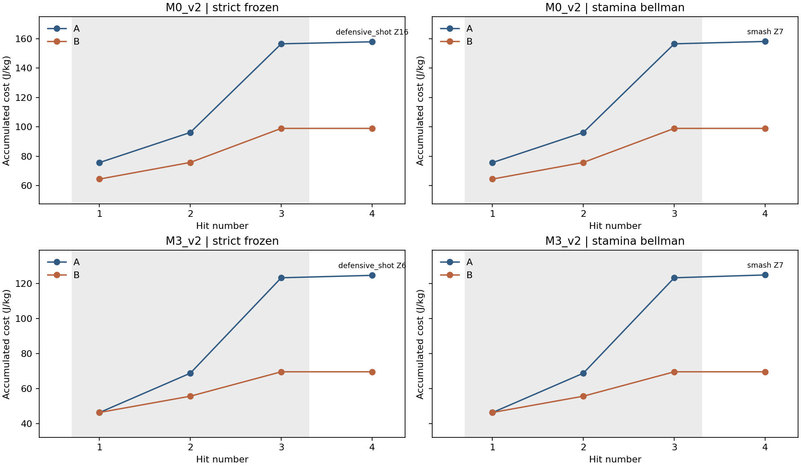

# 14. 첫 타구부터의 에너지 소모량과 전술 정책

## 1. 원인 / 하는 이유 / 개요

최근 세 타구의 도착 구획이 모인 네 번째 타구부터 전술을 선택한다. 이때까지 소모한 비용을 예산에서 차감하면 같은 구획 이력에서도 선수별 잔여량이 달라진다. 또 소모량이 같더라도 타구자와 상대에게 부여한 총예산에 따라 이어갈 수 있는 전이가 달라진다. 이 연구에서는 관측된 첫 세 타구의 비용을 시작 상태에 연결한 뒤, 이어지는 랠리에서 비용 제약과 체력 의존 종료 모형이 추천과 모형 승리 가치에 미치는 영향을 비교한다.

| 근거 | 이 연구에서의 역할 |
|---|---|
| [01 경기 자료](../01_data_16zone/REPORT.md), [04 Markov 모형](../04_markov_parity/REPORT.md) | 경기 단위 분할, 16개 구획과 최근 세 구획의 순서, 타구 차례 교대 |
| [02 GRU](../02_gru_probability/REPORT.md), [03 CQL](../03_cql_v2_policy/REPORT.md), [07 OPE](../07_policy_ope/REPORT.md) | 관측 승패 예측과 107차원 CQL, 타구 OPE는 배경이다. 직접 비교의 기준은 51차원 예산 CQL이다. |
| [05 예산 전략](../05_energy_budget/REPORT.md), [06 랠리 시뮬레이터](../06_rally_simulator/REPORT.md) | 양측 예산, 지원 제한과 고정 상대, 기존 strict 종료 모형을 사용하는 기준 정책 |
| [08 BFMD](../08_bfmd_kinematics/REPORT.md), [09 비용 전달](../09_cost_transfer_method/REPORT.md), [10 전체 전이 비용](../10_transition_energy/REPORT.md) | 추적 기반 운동학 특징과 경로 길이 보정, 전이 비용과 타구 비용의 구성 근거 |
| [11 통합 비용](../11_integrated_transition_energy/REPORT.md), [12 종료 재적합](../12_integrated_stamina_refit/REPORT.md) | M0_v2 및 M3_v2 비용표, 사건별 타구 직전 누적량, 고정 Q 타구별 종료 계수 |

## 2. 과정

### 비용 및 시작 상태

타구 $t$ 직전의 선수 $p$ 소모량을 $D_p(t)=\sum_{k<t}c_p(k)$, 잔여 예산을 $b_p(t)=B_p-D_p(t)$로 정의한다. 첫 관측 타구 직전 소모량은 0이다. $c_p(k)$에는 $k$번째 타격 비용과 다음 타구까지의 양측 이동 중 선수 $p$의 몫을 넣는다. 자연 종료한 타구에는 타격 비용만 부과한다. 도입부 비용은 사건별 추정 자료에서 가져오고, 이후 실제로 관측된 계속 전이는 같은 구획·타구 키의 정책 평가 비용을 적용한다. 12번의 비용 미확보 플래그와 M3_v2의 미지원 앞 타구에 대한 M0 이동비용 규칙을 보존한다.

주 분석의 분위수는 네 번째 타구에 진입하여 완전한 전이를 구성할 수 있었던 학습 랠리에서, 선수별 양의 전체 소비량으로 계산한다. 첫 세 타구의 사건별 비용과 이후 상태별 비용을 합산하는 정의다. 전체 사건별 비용과 완전한 짧은 랠리를 추가한 정의의 분위수를 함께 계산했다. 두 선수 모두 $b_p(4)>0$인 경우가 평가에 적격이다. 기존 정책과 비교할 때는 두 잔여량이 기존 모델·격자 범위 이내인 공통 시작 상태를 사용한다. 시작 상태를 추출할 때 구획 이력과 첫 세 타구 비용의 짝을 유지한다.

### 종료확률과 전술

| 환경 | 종료 확률 | 비교 목적 |
|---|---|---|
| A | 기존 strict M0 | 기존 평가 환경의 확률 구조 |
| B | 고정 Q와 타구별 절편만 적합한 모형 | 종료확률 구조를 바꾼 경우 |
| C | 고정 Q와 양측 누적 소모량의 타구별 계수 | 비용을 소모한 뒤 달라지는 종료 득점·실점 비율 |
| C0 | C의 절편, 기울기 0 | C와 같은 절편을 기준으로 한 누적 소모량 항의 효과 |

관측 확률질량의 $\pi(u\mid s)$를 제거하여 $p_T=(W_0+L_0)/\pi(u\mid s)$와 $p_C=\sum_j Q_j/\pi(u\mid s)$를 얻었다. 종료했을 때 타구자가 득점할 확률은 $\sigma(\log(W_0/L_0)+a_u-\beta_uD_H/D_*+\gamma_uD_R/D_*)$이다. $W_0$와 $L_0$는 현재 타구자 기준이다. 여기서 실점은 타구자의 패배로 랠리가 끝난 전체 사건을 뜻한다. $p_T$에 조건부 득점확률과 그 여확률을 곱하여 득점·실점 질량을 얻는다. 고정 상대의 타구·구획 분포는 세 환경에서 동일하다. 행동 후보는 기존 학습 자료의 지원 마스크를 사용한다. 행위자가 선택한 구획에 정상적으로 도달하는 조건부 모형이다.

Bellman 계산은 총예산을 각 조건에 고정한다. $D_p=B_p-b_p$이므로 양측 잔여 예산만 격자로 계산한다. 전략 선수는 지원된 타구와 목표 구획 중 즉시 득점 가치와 계속 가치의 합을 최대화하고, 상대 차례에는 경험 분포로 평균한다. CQL은 같은 격자 상태의 공간 및 차례 정보에 잔여량과 누적량을 각각 두 개씩 더한 53차원 입력을 쓴다. 자연 종료의 보상은 관측 승패이며, 계속 전이에서 소진된 뒤의 실제 기록은 잘라낸다. 순차적으로 이어지는 동일 선수의 다음 차례를 연결하고, 종료 목표 구획이 미상인 경우 기존 학습 분포로 분할한다. 후보 alpha는 0.1, 0.25, 0.5이고 최종 seed는 42–46이다.

보상은 전략 선수의 승리 +1, 패배 -1, 동시 소진 0이다. 계속 전이 후 한 선수의 예산만 0 이하가 되면 그 선수가 패배한다. 자연 종료는 소진보다 먼저 판정하며 마지막 타격 비용은 기록한다. 몬테카를로에서는 구획 이력, 첫 세 타구 비용과 시행·타구별 난수를 정책 간에 공유한다. 모형 승리 가치는 승리에 1, 동시 소진에 0.5를 부여한 평균이다. 신뢰구간은 동일한 난수에서 얻은 차이의 표본 오차를 나타내며 학습 seed 간 변동은 별도로 집계한다.

### 실행 명령

```powershell
python run.py prepare
python run.py stamina-ledger --run-id OPENING_RUN
python run.py stamina-refit-audit --run-id REFIT_AUDIT
python run.py stamina-historical --run-id HISTORICAL_RUN
python run.py stamina-policy-compare --run-id FROZEN_RUN --historical-run HISTORICAL_RUN
python run.py stamina-bellman-validate --run-id GRID_RUN --ledger-run OPENING_RUN --pair 25 25
python run.py stamina-cql build --model M0_v2 --ledger-id OPENING_RUN --run-id REPLAY_M0
python run.py stamina-cql train --dataset-id REPLAY_M0 --run-id FIT_M0
python run.py stamina-cql build --model M3_v2 --ledger-id OPENING_RUN --run-id REPLAY_M3
python run.py stamina-cql train --dataset-id REPLAY_M3 --run-id FIT_M3
python run.py stamina-policy-compare --stage updated --historical-run HISTORICAL_RUN --cql-training M0_v2=FIT_M0 --cql-training M3_v2=FIT_M3 --run-id CQL_RUN
python run.py stamina-policy-compare --stage bellman --historical-run HISTORICAL_RUN --bellman-run GRID_RUN --pair 25:25 --environments C --run-id BELLMAN_RUN
python run.py stamina-tactics --run-id TACTICS_RUN --bellman-run GRID_RUN
python run.py exec -m src.stamina_figures --run-id FIGURE_RUN --evaluation-run FROZEN_RUN --evaluation-run CQL_RUN --evaluation-run BELLMAN_RUN
```

동결 평가와 재현에는 03의 학습 체크포인트 및 완전 격자가 필요하다. 게시 폴더의 [M0 보관 명세](../03_cql_v2_policy/results/runs/20261105-complete-grid-storage-codex/RESTORE.md), [M3 보관 명세](../03_cql_v2_policy/results/runs/20261105-grid-storage-recovery-codex/RESTORE.md)와 [기존 실행 방법](../03_cql_v2_policy/REPORT.md)을 참조한다. 각 명령의 새 ID는 이전 실행과 겹치지 않게 지정한다. 14번의 검증 로그와 결과는 해당 주제의 `results/runs/`에 기록된다.

## 3. 결과

### 시작 상태와 예산

| 비용 회계 | p25 | p50 | p75 | p90 |
|---|---:|---:|---:|---:|
| M0_v2 기존 네 번째 이후 | 102.45 | 251.52 | 479.51 | 806.40 |
| M0_v2 첫 타구부터 | 195.32 | 348.26 | 582.96 | 906.06 |
| M3_v2 기존 네 번째 이후 | 103.51 | 255.61 | 488.32 | 826.13 |
| M3_v2 첫 타구부터 | 197.53 | 353.97 | 591.27 | 923.47 |

단위는 J/kg이다. 같은 학습 모집단에서 첫 타구부터의 비용을 두 가지 방식으로 기록했을 때 선수별 랠리 합계의 평균 절대 차이는 M0_v2에서 20.50 J/kg, M3_v2에서 22.43 J/kg이다. 학습/검증/시험의 네 번째 타구 후보는 각각 3,392/753/816개다. 양측 p25 조건에서 두 선수 모두 양의 잔량을 가진 학습 후보는 M0_v2 3,332개, M3_v2 3,310개다. 타구 시점별 누적량 그림의 모집단은 해당 타구 시점에 도달한 랠리다. [비용과 적격 기준 실행](results/runs/20261125-opening-cost-ledger-codex/RUN.json)

세 타구 안에 끝난 학습 랠리 539개는 전략 적용 범위 밖에 있다. 이들의 사건별 전체 비용을 분위수 모집단에 추가하는 민감도에서 p50은 M0_v2 300.14 J/kg, M3_v2 303.79 J/kg이었다. 이 정의와 모든 주석 랠리에 사건별 비용만 쓴 정의의 차이는 [비용 정의 비교](results/runs/20261125-opening-cost-ledger-codex/ledger_budget_table.csv) 및 [짧은 랠리 민감도](results/runs/20261125-opening-cost-ledger-codex/ledger_short_rally_sensitivity.csv)에 기록했다.




### 기준 정책 검증

기존 기본 32조건과 8개 정책의 모형 승리 가치를 M0_v2와 M3_v2 시행 자료에서 재집계하였다. 두 비용의 총 512개 정책·조건 집계가 기존 표와 일치했다. 각 비용에서 시작 타구자가 다른 기본 두 조건을 선택하여 정책별 20,000회씩 재실행했다. 비교한 640,000개 시행의 승패, 길이, 비용이 보존 결과와 일치했다. [기준 재현 실행](results/runs/20261125-historical-reproduction-codex/RUN.json)

### 고정 Q 종료확률 연결

12번의 검증·시험 자연 종료 1,569건을 새 정책 환경의 확률 함수로 다시 계산했다. 조건부 득점확률의 최대 절대 차이는 두 비용에서 $5.6\times10^{-16}$ 이하였고, 선수 A의 종료 승패 확률질량 차이는 $2.1\times10^{-17}$ 이하였다. 시험 816건의 조건부 로그손실은 B가 0.56122, C가 M0_v2 0.56530 및 M3_v2 0.56595였다. [종료확률 재현 실행](results/runs/20261125-stamina-refit-integration-audit-codex/RUN.json)

### 53차원 CQL 학습

| 비용 | 학습 전이 행 | 검증 전이 행 | 시험 전이 행 | 선택 alpha | 5개 seed의 최저 검증 TD 손실 범위 |
|---|---:|---:|---:|---:|---:|
| M0_v2 | 334,999 | 75,134 | 82,101 | 0.1 | 0.30332–0.31174 |
| M3_v2 | 333,769 | 74,953 | 82,212 | 0.1 | 0.30663–0.31104 |

전이 행 수에 총예산 조합별 반복 행과 종료 목표에 따른 가중 분할 행이 포함된다. 같은 선수의 다음 차례를 연결하는 모든 계속 전이와 관측 자연 종료 라벨을 대조했고, 두 모델의 체크포인트를 seed별로 저장했다. 검증 TD 손실을 낮추는 설정을 고정한 뒤 정책 롤아웃을 수행했다. [M0_v2 replay](results/runs/20261125-stamina-cql-m0-replay/RUN.json) · [M3_v2 replay](results/runs/20261125-stamina-cql-m3-replay/RUN.json) · [M0_v2 학습](results/runs/20261125-stamina-cql-m0-training/RUN.json) · [M3_v2 학습](results/runs/20261125-stamina-cql-m3-training/RUN.json)

### 동결 정책과 새 CQL의 평가

각 비용에서 4×4 예산 조합과 두 시작 차례를 합한 32조건을 동일하게 가중했다. 정책과 조건별로 20,000회를 시행했다. p90이 포함된 14조건에서는 양측 잔여 예산이 양수인 시작 상태·조건 쌍 가운데 M0_v2 8,075/23,684개(34.1%), M3_v2 7,377/23,660개(31.2%)가 기존 정책 입력 범위를 초과했다. 구간 내에서만 동결 정책을 비교했다. p90을 쓰지 않은 18조건의 시작 상태와 53차원 CQL 결과는 범위 제한을 풀어도 같았다. [동결 정책 평가](results/runs/20261125-frozen-stamina-paired-full-codex/RUN.json) · [53차원 CQL의 공통 범위](results/runs/20261125-updated-stamina-cql-paired-codex/RUN.json) · [53차원 CQL의 양의 잔량 전체](results/runs/20261125-updated-stamina-cql-all-codex/RUN.json)

| 비용 | 기존 Bellman A | 기존 Bellman B | 기존 Bellman C | 기존 Bellman C0 |
|---|---:|---:|---:|---:|
| M0_v2 | 66.00% | 68.40% | 68.06% | 68.40% |
| M3_v2 | 66.46% | 68.83% | 68.55% | 68.88% |

기존 Bellman에서 A와 B 사이의 평균 변화는 두 비용에서 각각 +2.40, +2.37%p였다. 체력 항만 달리한 C와 C0의 차이는 −0.34, −0.33%p였다. 두 비용 모두 이 조건의 동결 전략에서 종료확률 구조 변경이 기울기 추가보다 큰 차이를 냈다. C 환경에서 53차원과 51차원 CQL의 차이는 M0_v2 +0.102%p(쌍체 95% 몬테카를로 구간 [0.064, 0.139]), M3_v2 −0.169%p([−0.209, −0.129])였다. 53차원 CQL의 다섯 학습 seed 간 표준편차는 0.052, 0.081%p로 따로 계산했다.

### 새 Bellman의 수치 검증

| 비용 | 통과 조건 | 최대 독립 표본 잔차 | 선정 질의의 최대 격자 차이 | 정확 비용 MC와 격자의 최대 차이 |
|---|---:|---:|---:|---:|
| M0_v2 | 32/32 | $1.23\times10^{-15}$ | 0.01514 | 0.00729 |
| M3_v2 | 32/32 | $1.00\times10^{-15}$ | 0.01800 | 0.00680 |

잔차 기준은 $10^{-10}$, 격자와 정확 비용 MC의 차이 및 선정 질의의 세분화 차이 기준은 0.02였다. 독립 MC는 양측 잔량이 양수인 학습 진입 상태에서 조건별 20,000회를 시행했다. A/B 교환으로 고정 총예산 배열을 재사용할 때 확률과 비용 텐서의 대칭을 검사했다. 전체 격자의 크기와 SHA256 및 생성 명령은 실행 기록에 있다. [중간 예산 검사](results/runs/20261125-stamina-bellman-tier2-codex/RUN.json) · [큰 예산 검사](results/runs/20261125-stamina-bellman-tier3-codex/RUN.json)

처음에는 비용을 격자 간격으로 나누는 과정에 단정밀도 연산이 남아 독립 잔차 기준을 넘었다. 배정밀도로 다시 계산했으며, M3_v2의 8조건에는 양의 소액 잔량에서 다음 타구가 자연 종료할 수 있는 경계를 명시적으로 계산했다. 세분화 검사에 실패한 방식과 통과한 방식의 수치를 모두 기록했다. [초기 잔차 검사](results/runs/20261125-stamina-bellman-pilot-codex/RUN.json) · [M3_v2 경계 처리 검증](results/runs/20261125-stamina-bellman-m3-p25-boundary-codex/RUN.json) · [비대칭 예산 경계 재검증](results/runs/20261125-stamina-bellman-tier1-boundary-codex/RUN.json)

### 환경 C에서 다시 계산한 전략과 CQL

| 비용 | 동결 Bellman | 새 Bellman | 53차원 CQL 5개 seed 평균 | 새 Bellman − 53차원 CQL, 쌍체 95% MC 구간 |
|---|---:|---:|---:|---:|
| M0_v2 | 68.06% | 69.28% | 56.17% | +13.11%p [13.01, 13.20] |
| M3_v2 | 68.55% | 69.78% | 56.52% | +13.25%p [13.16, 13.35] |

동결 정책의 입력 범위 안에서는 새 Bellman의 가치가 각 비용에서 1.22%p씩 높아졌다. 자연 종료 승리가 M0_v2에서 30.85%에서 33.31%로, M3_v2에서 30.44%에서 32.97%로 늘었다. 상대만 예산을 소진한 비율은 각각 36.00%에서 34.79%로, 37.04%에서 35.77%로 낮아졌다. 따라서 동결 Bellman에서 새 Bellman으로 바꿀 때 자연 종료 승리가 늘자 가치가 높아졌다. 53차원 CQL과 비교할 때는 상대만 소진한 비율의 차이가 가장 컸다. CQL의 상대만 소진 비율은 각각 20.11%와 21.19%였다. [모형 승리 가치와 쌍체 구간](results/runs/20261125-stamina-domain-figures-codex/stamina_bellman_matched_summary.csv) · [종료 원인·비용·길이 통계](results/runs/20261125-stamina-domain-figures-codex/stamina_summary.csv)

동결 정책의 입력 범위를 적용하지 않고 양의 잔량을 가진 전체 시작 상태로 비교한 결과, 새 Bellman과 53차원 CQL의 가치는 M0_v2에서 69.83%와 56.45%, M3_v2에서 70.26%와 56.77%였다. 쌍체 차이는 각각 +13.38%p([13.29, 13.48])와 +13.49%p([13.40, 13.59])였다. 각 예산·차례별 동일 가중과 조건당 20,000회 기준은 유지했다. [전체 적격 상태의 정책 비교 및 그림](results/runs/20261125-stamina-all-eligible-figures-codex/RUN.json)



| 비교 자료 | M0_v2 | M3_v2 |
|---|---|---|
| 소모량에 따른 타구별 종료 조건부 득점확률 | [그림](results/runs/20261125-stamina-domain-figures-codex/stamina_conditional_win_M0_v2.png) | [그림](results/runs/20261125-stamina-domain-figures-codex/stamina_conditional_win_M3_v2.png) |
| 환경별 모형 승리 가치 | [그림](results/runs/20261125-stamina-domain-figures-codex/stamina_win_value_M0_v2_domain.png) | [그림](results/runs/20261125-stamina-domain-figures-codex/stamina_win_value_M3_v2_domain.png) |
| 양측 예산 조합별 새 Bellman과 새 CQL의 가치 차이 | [그림](results/runs/20261125-stamina-domain-figures-codex/stamina_heatmap_M0_v2_domain_bellman53_updated_mean.png) | [그림](results/runs/20261125-stamina-domain-figures-codex/stamina_heatmap_M3_v2_domain_bellman53_updated_mean.png) |
| 추천 타구, 목표 구획과 관측 지원 | [그림](results/runs/20261125-stamina-domain-figures-codex/stamina_recommendations_M0_v2_domain.png) | [그림](results/runs/20261125-stamina-domain-figures-codex/stamina_recommendations_M3_v2_domain.png) |

### 첫 세 타구 비용과 소진 판정의 민감도

동등 예산 p25, p50, p90과 각 시작 차례를 합해 비용 모형별 6조건을 비교했다. 공통 적격 학습 시작 상태에서 조건·정책별 20,000회를 시행했다. strict 환경 A에서 총예산을 고정하고 첫 세 타구 비용을 차감하니 지원 제한 경험 정책의 평균 가치가 M0_v2에서 50.68%에서 43.73%로, M3_v2에서 50.99%에서 44.65%로 낮아졌다. 이는 같은 출발 구획의 잔여 예산이 줄어든 효과다.

고정 Q와 양측 소모량을 사용한 C에서는 소진 즉시 패배를 적용할 때 예산 미고려 전략이 M0_v2 51.07%, M3_v2 51.60%였다. 소진 판정을 제거하고 비용 누적을 계속하니 각각 69.19%, 69.34%로 높아졌다. 이 비교에는 두 환경 모두에서 행동을 정의할 수 있는 예산 미고려 전략과 지원 제한 경험 정책을 사용했다. [공통 시작 상태 민감도 실행](results/runs/20261125-opening-and-exhaustion-sensitivity-codex/RUN.json)

### 대표 전술 변화

M0_v2 p25 동등 예산에서 구획 이력 2–7–10, 타구자와 상대의 첫 세 타구 소모량 156.57 및 98.94 J/kg을 사용했다. strict 종료 모형으로 계산한 기존 전략은 수비 타구 Z16을, 체력 의존 종료 모형으로 다시 계산한 전략은 스매시 Z7을 골랐다. 같은 C 환경에서 두 행동의 가치 차이는 0.289였다. 이 비교에는 두 종료 모형의 구조와 전략 재계산이 함께 반영된다.

M3_v2에서 구획 이력 10–3–10을 고정하고 상대 소모량을 123.71 J/kg으로 유지했다. 같은 이력의 관측 범위에서 타구자 소모량을 94.34에서 105.53 J/kg으로 바꾸니, 타구자 잔량은 103.19에서 92.00 J/kg으로 줄었고 추천이 헤어핀 Z10에서 스매시 Z7로 바뀌었다. 각 행이 동일한 총예산을 지킨다. [상황별 행동 가치와 실행 기록](results/runs/20261125-stamina-tactical-cases-codex/RUN.json)

C0에서도 위의 헤어핀에서 스매시로의 변화가 나타났다. C와 C0의 격자 간격과 질의 방법을 맞추고 양측 소모량을 고정한 p25 진입 상태 전수 비교에서는 M0_v2의 67/3,332개와 M3_v2의 62/3,310개에서 추천이 달랐다. 초기 비교에서 M3_v2 일부에 서로 다른 격자와 보간 방식을 사용한 표는 검증 실패로 표시했다. [같은 격자에서의 기울기 비교](results/runs/20261125-stamina-tactical-fixed-load-matched-codex/RUN.json) · [초기 비교 감사](results/runs/20261125-stamina-tactical-fixed-load-codex/RUN.json)



### 해석 범위

종료 재적합에서 소모량을 넣은 모형은 보존된 시험 자료에서 조건부 종료 예측을 개선하지 못했다. 여기서 에너지의 단위는 이동 및 타격 비용 대리량에 적용한다. 정책 평가의 분모는 지정한 예산으로 네 번째 타구에 진입한 시작 상태다. 결과는 이 추정 환경과 고정 상대에서의 전술 비교에 적용된다. 동일 경기 안의 회복, 선수를 바꾸었을 때의 대응, 종료 계수를 다시 적합했을 때의 안정성은 별도의 검증 과제로 남는다.
