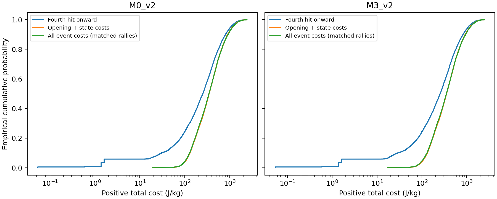

# 14. 첫 타구부터의 에너지 소모량과 전술 정책

## 1. 원인 / 하는 이유 / 개요

최근 세 타구의 도착 구획이 모인 네 번째 타구부터 전술을 선택한다. 이때까지 소모한 비용을 예산에서 차감하면 같은 구획 이력에서도 선수별 잔여량이 달라진다. 또 소모량이 같더라도 타구자와 상대에게 부여한 총예산에 따라 이어갈 수 있는 전이가 달라진다. 이 연구에서는 관측된 첫 세 타구의 비용을 시작 상태에 연결한 뒤, 이어지는 랠리에서 비용 제약과 체력 의존 종료 모형이 추천과 모형 승리 가치에 미치는 영향을 비교한다.

| 근거 | 이 연구에서의 역할 |
|---|---|
| [01 경기 자료](../01_data_16zone/REPORT.md), [04 Markov 모형](../04_markov_parity/REPORT.md) | 경기 단위 분할, 16개 구획과 최근 세 구획의 순서, 타구 차례 교대 |
| [02 GRU](../02_gru_probability/REPORT.md), [03 CQL](../03_cql_v2_policy/REPORT.md), [07 OPE](../07_policy_ope/REPORT.md) | 관측 승패 예측과 107차원 CQL, 타구 OPE는 배경이다. 직접 비교의 기준은 51차원 예산 CQL이다. |
| [05 예산 전략](../05_energy_budget/REPORT.md), [06 랠리 시뮬레이터](../06_rally_simulator/REPORT.md) | 양측 예산, 지원 제한과 고정 상대, 기존 strict 종료 모형을 사용하는 기준 정책 |
| [08 BFMD](../08_bfmd_kinematics/REPORT.md), [09 비용 전달](../09_cost_transfer_method/REPORT.md), [10 전체 전이 비용](../10_transition_energy/REPORT.md) | 추적 기반 운동학 특징과 경로 길이 보정, 전이 비용과 타구 비용의 구성 근거 |
| [11 통합 비용](../11_integrated_transition_energy/REPORT.md), [12 종료 재적합](../12_integrated_stamina_refit/REPORT.md) | M0_v2 및 M3_v2 비용표, 사건별 타구 직전 누적량, 고정 Q 타구별 종료 계수 |

## 2. 과정

### 비용 및 시작 상태

타구 $t$ 직전의 선수 $p$ 소모량을 $D_p(t)=\sum_{k<t}c_p(k)$, 잔여 예산을 $b_p(t)=B_p-D_p(t)$로 정의한다. 첫 관측 타구 직전 소모량은 0이다. $c_p(k)$에는 $k$번째 타격 비용과 다음 타구까지의 양측 이동 중 선수 $p$의 몫을 넣는다. 자연 종료한 타구에는 타격 비용만 부과한다. 도입부 비용은 사건별 추정 자료에서 가져오고, 이후 실제로 관측된 계속 전이는 같은 구획·타구 키의 정책 평가 비용을 적용한다. 12번의 비용 미확보 플래그와 M3_v2의 미지원 앞 타구에 대한 M0 이동비용 규칙을 보존한다.

주 분석의 분위수는 네 번째 타구에 진입하여 완전한 전이를 구성할 수 있었던 학습 랠리에서, 선수별 양의 전체 소비량으로 계산한다. 첫 세 타구의 사건별 비용과 이후 상태별 비용을 합산하는 정의다. 전체 사건별 비용과 완전한 짧은 랠리를 추가한 정의의 분위수를 함께 계산했다. 두 선수 모두 $b_p(4)>0$인 경우가 평가에 적격이다. 기존 정책과 비교할 때는 두 잔여량이 기존 모델·격자 범위 이내인 공통 시작 상태를 사용한다. 시작 상태를 추출할 때 구획 이력과 첫 세 타구 비용의 짝을 유지한다.

### 종료확률과 전술

| 환경 | 종료 확률 | 비교 목적 |
|---|---|---|
| A | 기존 strict M0 | 기존 평가 환경의 확률 구조 |
| B | 고정 Q와 타구별 절편만 적합한 모형 | 종료확률 구조를 바꾼 경우 |
| C | 고정 Q와 양측 누적 소모량의 타구별 계수 | 비용을 소모한 뒤 달라지는 종료 득점·실점 비율 |
| C0 | C의 절편, 기울기 0 | C와 같은 절편을 기준으로 한 누적 소모량 항의 효과 |

관측 확률질량의 $\pi(u\mid s)$를 제거하여 $p_T=(W_0+L_0)/\pi(u\mid s)$와 $p_C=\sum_j Q_j/\pi(u\mid s)$를 얻었다. 종료했을 때 타구자가 득점할 확률은 $\sigma(\log(W_0/L_0)+a_u-\beta_uD_H/D_*+\gamma_uD_R/D_*)$이다. $W_0$와 $L_0$는 현재 타구자 기준이다. $p_T$에 이 조건부 확률과 그 여확률을 곱하여 득점·실점 질량을 얻는다. 고정 상대의 타구·구획 분포는 세 환경에서 동일하다. 행동 후보는 기존 학습 자료의 지원 마스크를 사용한다. 행위자가 선택한 구획에 정상적으로 도달하는 조건부 모형이다.

Bellman 계산은 총예산을 각 조건에 고정한다. $D_p=B_p-b_p$이므로 양측 잔여 예산만 격자로 계산한다. 전략 선수는 지원된 타구와 목표 구획 중 즉시 득점 가치와 계속 가치의 합을 최대화하고, 상대 차례에는 경험 분포로 평균한다. CQL은 같은 격자 상태의 공간 및 차례 정보에 잔여량과 누적량을 각각 두 개씩 더한 53차원 입력을 쓴다. 자연 종료의 보상은 관측 승패이며, 계속 전이에서 소진된 뒤의 실제 기록은 잘라낸다. 순차적으로 이어지는 동일 선수의 다음 차례를 연결하고, 종료 목표 구획이 미상인 경우 기존 학습 분포로 분할한다. 후보 alpha는 0.1, 0.25, 0.5이고 최종 seed는 42–46이다.

보상은 전략 선수의 승리 +1, 패배 -1, 동시 소진 0이다. 계속 전이 후 한 선수의 예산만 0 이하가 되면 그 선수가 패배한다. 자연 종료는 소진보다 먼저 판정하며 마지막 타격 비용은 기록한다. 몬테카를로에서는 구획 이력, 첫 세 타구 비용과 시행·타구별 난수를 정책 간에 공유한다. 모형 승리 가치는 승리에 1, 동시 소진에 0.5를 부여한 평균이다. 신뢰구간은 동일한 난수에서 얻은 차이의 표본 오차를 나타내며 학습 seed 간 변동은 별도로 집계한다.

### 실행 명령

```powershell
python run.py prepare
python run.py stamina-ledger --run-id OPENING_RUN
python run.py stamina-historical --run-id HISTORICAL_RUN
python run.py stamina-policy-compare --run-id FROZEN_RUN --historical-run HISTORICAL_RUN
python run.py stamina-bellman-validate --run-id GRID_RUN --ledger-run OPENING_RUN --pair 25 25
python run.py stamina-tactics --run-id TACTICS_RUN --bellman-run GRID_RUN
```

동결 평가와 재현에는 03의 학습 체크포인트 및 완전 격자가 필요하다. 게시 폴더의 [M0 보관 명세](../03_cql_v2_policy/results/runs/20261105-complete-grid-storage-codex/RESTORE.md), [M3 보관 명세](../03_cql_v2_policy/results/runs/20261105-grid-storage-recovery-codex/RESTORE.md)와 [기존 실행 방법](../03_cql_v2_policy/REPORT.md)을 참조한다. 각 명령의 새 ID는 이전 실행과 겹치지 않게 지정한다. 14번의 검증 로그와 결과는 해당 주제의 `results/runs/`에 기록된다.

## 3. 결과

### 시작 상태와 예산

| 비용 회계 | p25 | p50 | p75 | p90 |
|---|---:|---:|---:|---:|
| M0_v2 기존 네 번째 이후 | 102.45 | 251.52 | 479.51 | 806.40 |
| M0_v2 첫 타구부터 | 195.32 | 348.26 | 582.96 | 906.06 |
| M3_v2 기존 네 번째 이후 | 103.51 | 255.61 | 488.32 | 826.13 |
| M3_v2 첫 타구부터 | 197.53 | 353.97 | 591.27 | 923.47 |

단위는 J/kg이다. 같은 학습 모집단에서 첫 타구부터의 비용을 두 가지 방식으로 기록했을 때 선수별 랠리 합계의 평균 절대 차이는 M0_v2에서 20.50 J/kg, M3_v2에서 22.43 J/kg이다. 학습/검증/시험의 네 번째 타구 후보는 각각 3,392/753/816개다. 양측 p25 조건에서 두 선수 모두 양의 잔량을 가진 학습 후보는 M0_v2 3,332개, M3_v2 3,310개다. 타구 시점별 누적량 그림의 모집단은 해당 타구 시점에 도달한 랠리다. [비용과 적격 기준 실행](results/runs/20261125-opening-cost-ledger-codex/RUN.json)




### 기준 정책 검증

기존 기본 32조건과 8개 정책의 모형 승리 가치를 M0_v2와 M3_v2 시행 자료에서 재집계하였다. 두 비용의 총 512개 정책·조건 집계가 기존 표와 일치했다. 각 비용에서 시작 타구자가 다른 기본 두 조건을 선택하여 정책별 20,000회씩 재실행했다. 비교한 640,000개 시행의 승패, 길이, 비용이 보존 결과와 일치했다. [기준 재현 실행](results/runs/20261125-historical-reproduction-codex/RUN.json)

### 해석 범위

종료 재적합에서 소모량을 넣은 모형은 보존된 시험 자료에서 조건부 종료 예측을 개선하지 못했다. 여기서 에너지의 단위는 이동 및 타격 비용 대리량에 적용한다. 정책 평가의 분모는 지정한 예산으로 네 번째 타구에 진입한 시작 상태다. 결과는 이 추정 환경과 고정 상대에서의 전술 비교에 적용된다.
